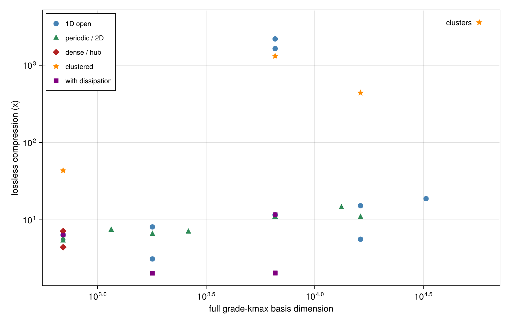
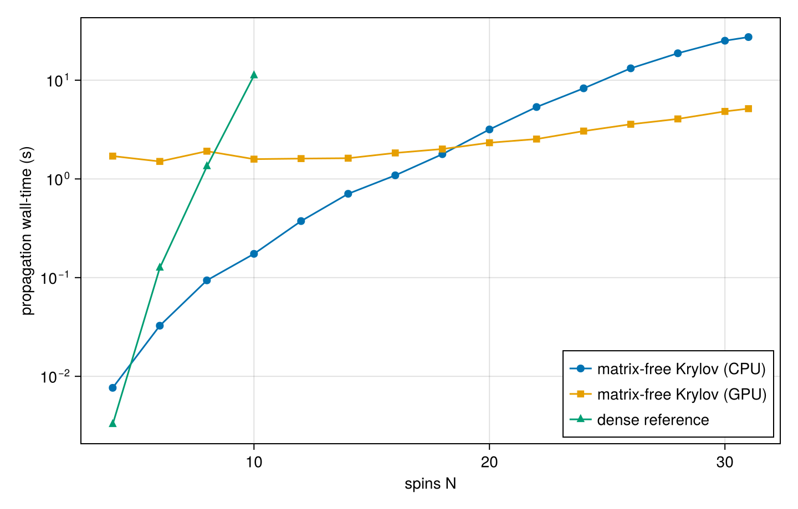
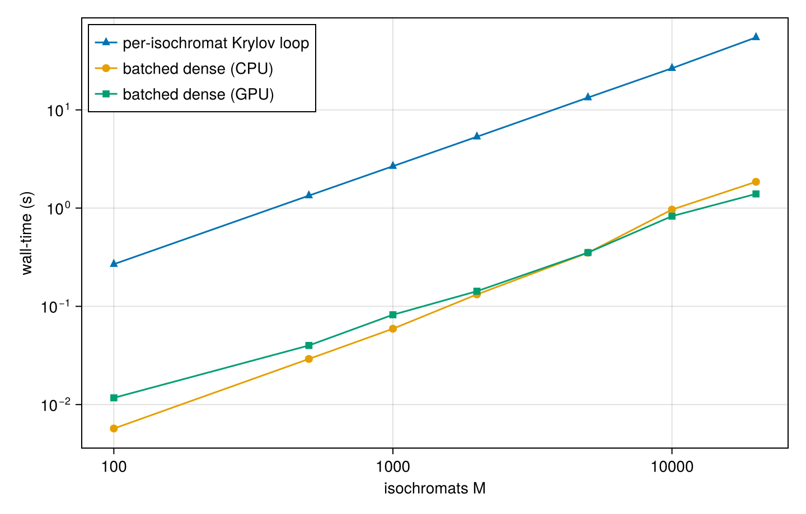

# Benchmarks

What the restricted-basis method buys in practice, in three parts: **exact reductions** that shrink the state
space (and compose), a matrix-free **propagator that scales** to large `N`, and the **reduced-dynamics and
non-normal diagnostics** that come with grade truncation. All timings below are on an RTX 4070 (+ CPU). This is the performance side of the story; for correctness (the method reproducing known
physics against analytic and exact references) see [Validation](validation.md).

## Headline

- **A real 22-spin natural product (strychnine) runs a full 2D NOESY pulse program from first-principles DFT
  couplings**, its grade-3 restricted basis of 43,726 rows standing in for `4^22 ≈ 1.8e13` rows of full
  Liouville space (the `256 x 1024` `noesygpph` acquisition is in [Validation](validation.md)).
- **Reachable-set truncation compresses a 57,205-row basis to 16 rows, losslessly** (obs_err ~ 6e-16) when
  the observable is local on a weakly-connected system.
- **The reductions compose: 312x on a real radical + solvent mixture**: observable-informed reachability
  times fast-electron elimination, for a radical-proton observable.
- **N = 64 spins live in a 20-row symmetric sector** (`kmax = 3`) versus `4^64 ≈ 3.4e38` (spin-1/2) in full
  Liouville space.
- **A 20,000-isochromat inhomogeneous ensemble (400,000 Liouville-space rows) propagates exactly in 1.4 s**,
  39x faster than a per-isochromat loop.

## Shrinking the State Space

The method's core is a stack of **exact, composable** reductions. Grade truncation sets the ceiling; on top
of it, point-group / permutation symmetry, generator- and observable-informed reachability, and (for a fast
subsystem) mean-field elimination each shrink the basis along an independent axis, so they multiply.

### Grade and Symmetry

Independent of the dynamics, exact reductions shrink the basis itself:

- **Coherence-order sectors:** `restricted_basis(N, kmax; parity = :even)` ~2x; `weight = w` ~3-8x.
- **Site-permutation symmetry:** [`SpinClasses`](@ref) collapses one class of magnetically-equivalent
  spins to `C(kmax+3, 3)` rows *independent of N* (spin-1/2; the `3`s become `d^2-1` for spin-S): at
  `N = 30, kmax = 4` that is **2,333,431 -> 35**.
- **Multi-dimensional irreps:** on Oh (`N = 6, kmax = 4`) the full block decomposition takes the spectrum
  **5.7x faster than a dense `eigen`**, matching it to 4e-12.
- **The ceiling:** a full 64-spin symmetric sector is just `C(6, 3) = 20` rows (`kmax = 3`) versus
  `4^64 ≈ 3.4e38` in full Liouville space. The `N <= 64` limit is structural (the propagation floor is in
  [Reduced Dynamics and Diagnostics](@ref)).

### Reachability and the Observable-Informed Basis

The generator/state-informed truncation ([`reachable_basis`](@ref), [`propagate_adaptive`](@ref)) keeps
only the grade-`kmax` strings actually reachable from the initial state (and, in the observable-informed
`:observable` direction, back-reachable from the observable). It is *lossless* (the restricted dynamics
equal the full grade-`kmax` dynamics to machine precision) and the compression **grows with system
size**, because the full grade-`kmax` basis grows far faster than the reachable set.

| System | full grade-3 dim | reachable dim | lossless compression | obs_err |
| :--- | :--- | :--- | :--- | :--- |
| chain, N=8, local | 1,789 | 221 | 8.1x | 1e-16 |
| chain, N=16, local | 16,249 | 1,069 | 15.2x | 1e-16 |
| chain, N=20, local | 32,551 | 1,733 | 18.8x | 1e-16 |
| **8x 3-clusters, N=24, local (hero)** | **57,205** | **16** | **3,575x** | **6e-16** |

Trading a little accuracy (the `zero_track_elimination` / lossy `propagate_adaptive` drop) traces a
Pareto frontier that reaches far higher compression, e.g. chain N=20 to **486x** at obs_err ~ 0.27.

The online adaptive engine runs on the CPU; the static [`reachable_basis`](@ref) reduced generator can be
handed to `propagate(...; backend = :gpu)` when it is large enough to benefit (see the note in
[`propagate_adaptive`](@ref)).

### Composing Reductions

These reductions stack, and the automatic ones adapt to the problem. A good stress
case is a heterogeneous mixture: a nitroxide radical (TEMPOL-like: electron + ¹⁵N + ring protons) in solvent,
some of it coupled to the radical, some bulk. The electron is a hyperfine hub for its own molecule, so what
an observable needs depends on where it sits.

**(a)** the `:observable` direction keeps only the strings on a path from the state to the measured
quantity, so the basis is tailored to the observable: from **5 rows** for a bulk-solvent proton far from
the radical (997x), to **139** for a radical proton that pulls in the whole paramagnetic cluster (36x), each
exactly lossless (`obs_err = 0`). **(b)** the reductions stack. For the radical proton, grade truncation
(4984 rows) composes with observable-informed reachability (139) and then [`mean_field_reduce`](@ref) folding
the fast electron into a mean field plus a paramagnetic-relaxation channel (16 rows): **312x together**. The
electron fold also removes the GHz clock that makes the full joint electron-nuclear system stiff.
Grade/memory tiering ([`grade_tiers`](@ref)) automates the grade choice on top; the reductions are
independent axes that multiply.

## Propagation at Scale

With the basis reduced, the matrix-free Krylov propagator scales to large `N`, and an exact batched
propagator handles inhomogeneous ensembles.

### Backend Scaling

For a fixed grade (`kmax = 3`) the restricted basis grows polynomially in `N`, and the matrix-free Krylov
propagator ([`propagate`](@ref)) tracks the sparse `nnz(𝓛)` rather than the dense `dim^2`. The dense
matrix-exponential reference ([`propagate_dense`](@ref)) hits a storage wall early; the
[`propagate_gpu`](@ref) path pulls ahead at large `N`.

| N | basis dim | nnz(𝓛) | dense (s) | Krylov CPU (s) | Krylov GPU (s) |
| :--- | :--- | :--- | :--- | :--- | :--- |
| 10 | 3,676 | 180,476 | 11.1 | 0.17 | 1.6 |
| 20 | 32,551 | 2,922,151 | DNF (17 GB) | 3.2 | 2.3 |
| 31 | 125,644 | 16,834,148 | DNF (253 GB) | 27.4 | 5.1 |

At N=10 the sparse Krylov path already beats dense 64x; by N=31 the dense reference would need ~253 GB,
while the GPU propagates the 125,644-row system in ~5 s. (The GPU path carries a fixed ~1.5 s CUDA warm-up
floor, so it only wins once the work exceeds it.)

### Batched Inhomogeneous Ensembles

An inhomogeneous ensemble is binned into `M` isochromats, independent generators `L_m = L0 + δ_m·D`
sharing a (SpinClasses-reduced) basis, summed at readout. [`propagate_ensemble`](@ref) forms the exact
per-block propagator `exp(dt·L_m)` ahead of time and applies it to all `M` blocks as a single batched matvec
(`gemm_strided_batched!` on the GPU). It is machine-precision exact, and reframing the per-isochromat
Krylov loop as a batched dense propagator is the dominant win; the device is secondary.

| M isochromats | Liouville rows | per-isochromat loop (s) | batched CPU (s) | batched GPU (s) |
| :--- | :--- | :--- | :--- | :--- |
| 1,000 | 20,000 | 2.67 | 0.06 | 0.08 |
| 5,000 | 100,000 | 13.33 | 0.35 | 0.35 |
| 20,000 | 400,000 | 54.62 | 1.85 | 1.40 |

The batched reformulation is ~30x over the loop on the CPU alone; the GPU adds a further ~1.3x at large
`M` (it is launch/overhead-bound at these small per-block sizes, so `precision = :single` gives no gain).

## Reduced Dynamics and Diagnostics

Grade truncation discards the high-order complement; this block is about what that costs and how to control
it, by folding the complement back onto the kept core as a memory kernel rather than dropping it.

### The Memory Kernel

Grade truncation need not *drop* the discarded correlations. The complement can be folded back onto the kept
core as a Nakajima-Zwanzig memory kernel ([`grade_tiers`](@ref) / [`grade_reduce`](@ref) assign each grade
shell one of the tiers `:exact`, `:memory` (non-Markovian kernel), `:markov` (Schur fold,
[`effective_liouvillian`](@ref)), or `:drop`, under one `err_tol` knob; see
[Nakajima-Zwanzig Formalism](@ref)).

Whether such a complement can be folded cheaply (a short Markovian kernel versus a long one) is set by
the complement generator `Q𝓛Q`, which is **non-normal**, so its spectral abscissa gives only the tail rate
and the kernel `K(τ) = P𝓛Q e^{τ Q𝓛Q} Q𝓛P` can grow transiently before it decays. The
[Spectral (Contour)](@ref) tools bound `‖K(τ)‖` rigorously:

On the engineered block (left) the kernel humps to 3.1x before decaying (`:stable_transient`); the numerical
abscissa `ω > 0` and the Kreiss bracket bound the hump, where the spectral abscissa `α` (the tail slope)
undershoots it. On the physical grade-1 | grade-2 kernel of a collectively-decaying spin system (right) the
numerical abscissa `ω < 0` *certifies* monotone decay (`:stable_monotone`). These are the meters behind the
`:memory`-versus-`:markov` tier choice.
