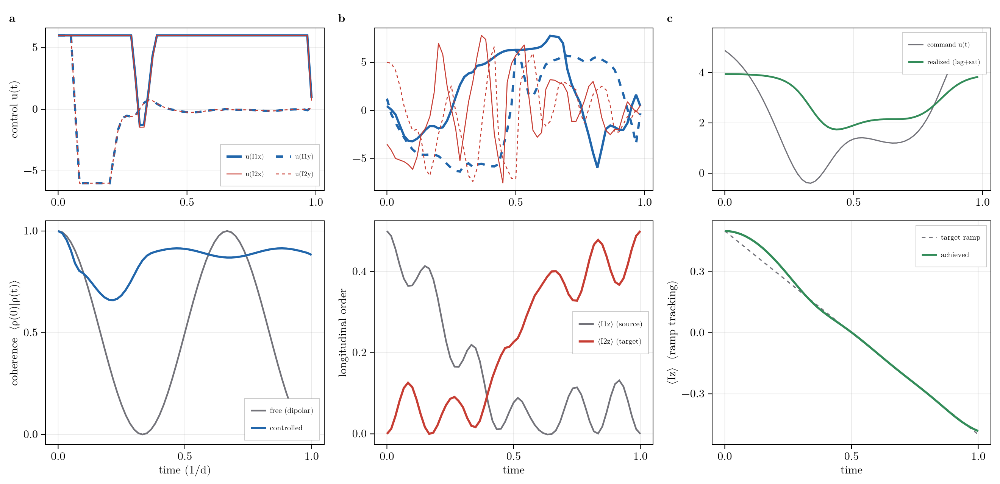

# Control and Pulse Optimization

RSD differentiates through the control problem directly, rather than wrapping an outside optimizer around the
solver. The generator is **affine in its parameters**: a drift plus fixed superoperators, each scaled by a
control or structural parameter,

```math
\mathcal{L}(t) = \mathcal{L}_\text{drift} + \sum_j u_j(t)\,\mathcal{L}_j^\text{drive}
                 + \sum_a \theta_a\,G_a^\text{struct},
```

so every parameter derivative is a cached superoperator (`build_liouvillian` is affine in each term). A GRAPE
adjoint sweep then gives the gradient of any objective with respect to *all* of the control amplitudes
`u_j(t)`, the pulse shapes, and the structural parameters `θ_a` (couplings, rates) from **one
forward and one backward propagation**, independent of the number of parameters. The optimizer runs in the
same basis as the forward dynamics, truncated by grade, so pulse and parameter design inherit the polynomial
scaling of the package.

!!! warning "Experimental"

    The control/GRAPE surface is experimental; the API may still change. It is validated against central
    finite differences in `test/test_control.jl` and `scripts/validation/validate_grape.jl`.

## The Control Problem

A control problem pairs a [`modulation`](@ref) (the drift plus the control drives) with a
[`ControlObjective`](@ref), assembled by [`control`](@ref) into a [`ControlProblem`](@ref) and solved by
[`grape`](@ref):

```@example control
using RestrictedSpinDynamics
N     = 2
basis = restricted_basis(N, N)
H     = hamiltonian(zeeman(N, [0.0, 5.0]), jcoupling(N, 1, 2, 3.0))   # drift
yunit = drive_field(N, 1:N; ω1 = 1.0, phase = π/2)                    # a controllable drive field
mod   = modulation(N, H, drive(yunit, t -> 0.6))                      # drift + one drive (0.6 = initial amplitude)
c0    = ComplexF64.(product_state_coeffs(basis; mags = [(1, 0, 0), (1, 0, 0)]))   # start along x
prob  = control(mod, MaximizeExpectation(spin_pm(N, 1, +1)))          # maximize Re⟨I+⟩ on spin 1

res   = grape(basis, prob, c0, range(0, 1; length = 41); iters = 100)                     # :adam (default)
alt   = grape(basis, prob, c0, range(0, 1; length = 41); iters = 100, optimizer = :ascent)
(adam = round(res.value, digits = 3), ascent = round(alt.value, digits = 3))
```

The control amplitudes are constant on each interval of the propagation grid, so `grape` optimizes one number
per drive per interval and returns the optimized `amplitudes` (`ndrive × (length(ts) - 1)`), structural
`params`, `actuators`/`parametric` command and shape values, the objective `value`, its `history` over the
iterations, and a forward replay (`final_state`/`trajectory`) at the optimum. A `Selective` drive envelope (one
that depends on the state) is rejected: the closed loop is no longer affine in the controls.

Each iteration is one forward and one backward propagation ([`control_gradient`](@ref)); `optimizer` sets how
that gradient becomes a step:

- **`:ascent`**: normalized gradient ascent, `u += lr · g/‖g‖`, a fixed-length step `lr` along the unit
  gradient direction. It uses one global step size for every amplitude; transparent and predictable, but slow
  to cross flat directions and prone to zig-zag when the control landscape is ill-conditioned (the usual case,
  with one amplitude per interval).
- **`:adam`** (default): adaptive moment estimation, `u += lr · m̂ / (√v̂ + ε)`. It keeps a running mean `m̂`
  (momentum) and variance `v̂` of the gradient *per parameter*, so each coordinate gets its own effective step;
  flat and steep directions both make progress, and the step auto-damps as the variance grows. In the example
  above the two reach different optima in the same 100 iterations (adam the higher), which is typical: `:adam`
  is the robust default for the many-parameter GRAPE problem, while `:ascent` is the lighter-weight choice when
  the gradient is already well-scaled and a simple fixed step is wanted.

## Objectives

[`ControlObjective`](@ref) is the abstract cost functional; a concrete objective supplies the scalar cost at
the final state and the terminal costate that seeds the adjoint sweep:

- [`MaximizeExpectation`](@ref): drive `Re<O>` up (state transfer, polarization).
- [`StateOverlap`](@ref): maximize the overlap with a target state.
- [`TrajectoryFit`](@ref): a running cost that tracks one or several target trajectories (one observable, or
  several channels) over the whole window.

## Actuators and Parametric Drives

Two layers sit between the optimizer and the raw amplitudes when a bare waveform, one value per interval, is
not the right handle:

- [`actuator`](@ref) wraps a generator term in a physical response: a `lag` time constant (first order),
  `:langmuir` `saturation`, box `bounds`, and an initial command. The optimizer commands the actuator; the
  actuator drives the generator. This models a real knob (a pump, a field coil) that cannot slew or push
  arbitrarily hard.
- [`ParametricDrive`](@ref) replaces that waveform with a smooth envelope `u(t) = f(θ, t)` of a few shape
  parameters, so GRAPE optimizes `θ` (amplitude, center frequency, sweep rate) rather than one value per
  interval; this is the parametric pulse (CRAB) step, limited in bandwidth by construction. Build one with
  [`parametric_drive`](@ref) and any envelope `f(θ, t)` (for example a linear chirp, the optimizable sibling of
  the fixed [`chirp_drive`](@ref)). The gradient chains the adjoint, interval by interval, through the ansatz
  Jacobian `∂f/∂θ`, with no extra propagation.

## The Adjoint Gradient

[`control_gradient`](@ref) is the engine underneath [`grape`](@ref): one forward trajectory and one backward
costate sweep (seeded by the objective) yield every parameter gradient at once, since control amplitudes and
structural parameters carry the identical adjoint gradient `Re<λ, G·c>` and differ only in the time reduction
(one value per interval versus summed over the window). The forward trajectory and the backward costate are
the two sides of [trace duality](@ref "The Adjoint and Trace Duality"), the Schrodinger and Heisenberg
pictures of the same expectation.

Structural parameters ride that same adjoint. The `structural` argument to [`control`](@ref) declares tunable
drift parameters (a coherent term or jump list of unit strength added as `θ_a·∂𝓛/∂θ_a`), so GRAPE optimizes
couplings and rates alongside the pulses; this is how a handle on engineered dissipation or a gain bias (the
pH2 rate a SABRE RASER actually turns) enters the optimization.

The downstream layer for the inverse problem (system identification and state estimation) reuses this adjoint;
it lives in the [Inference](@ref "Inference (System ID & State Estimation)") submodule.

## Worked Examples: Gradient-Based Control

One forward and one backward propagation differentiate any objective through the restricted-basis dynamics, so
the same [`control`](@ref)/[`grape`](@ref) call solves different control problems by swapping only the
objective, and where the knob is not a bare waveform, the actuator chain.

```julia
prob = control(mod, objective; bounds = (-8.0, 8.0), actuators = ...)   # objective is the only variable
res  = grape(basis, prob, c0, ts; iters = 300, optimizer = :adam, lr = 0.3)
```



Columns (a)-(c): three objectives. Top row, the optimized pulse; bottom row, the dynamics it drives.

- **(a) Coherence preservation (decoupling).** A [`TrajectoryFit`](@ref) holds the transverse coherence
  ``\langle\rho(0)|\rho(t)\rangle`` at its initial value against a dipolar coupling that otherwise collapses and
  revives it; it stays above 0.66, settling near 0.88. The exact-dynamics, finite-pulse analogue of
  perturbative [Average Hamiltonian (AHT)](@ref) decoupling.
- **(b) Polarization transfer.** A [`MaximizeExpectation`](@ref) on ``\langle I_{2z}\rangle`` drives an
  INEPT-like transfer across the J-coupling: ``\langle I_{1z}\rangle`` empties from ``\tfrac12`` to zero while
  ``\langle I_{2z}\rangle`` fills to ``\tfrac12``.
- **(c) Actuator-aware control.** An [`actuator`](@ref) (first-order lag, `:tanh` saturation) sits between
  GRAPE's command and the realized drive. Commanding ``\langle I_z\rangle`` along a ``+\tfrac12`` to
  ``-\tfrac12`` ramp, the realized value tracks it but falls short near the endpoints, where the demanded drive
  exceeds the saturation limit.

All three share one gradient, basis, and propagator. Script: `scripts/control/gradient_control_showcase.jl`.

```@autodocs
Modules = [RestrictedSpinDynamics]
Pages = ["control.jl"]
Private = false
```

## See Also

- [Reachability, Control, and the Adaptive Basis](@ref): which basis a control problem can reach, and
  truncation informed by control.
- [Inference and System Identification](@ref): the inverse problem built on this adjoint.
- [Time Propagation](@ref): the forward steppers the gradient differentiates through.
