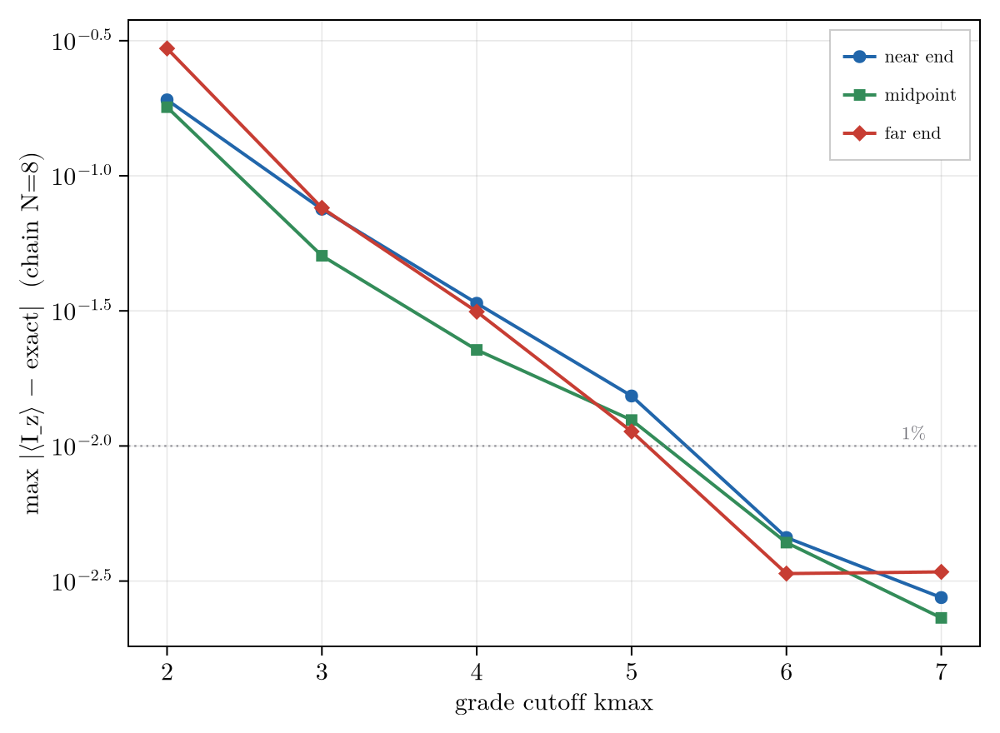

# The Convergence Rate

When the cutoff sits below the floor ([The Exactness Condition](@ref)), grade truncation is a
convergence-controlled approximation. Its error is a correlation light-cone whose per-grade decay is a
gauge-invariant structural property of the generator, computable before any propagation.

## The Correlation Light-Cone

Truncation discards the correlation order that has spread past the cutoff, and that spreading is ballistic.
From a localized start the grade-``k`` amplitude follows a light-cone envelope,

```math
a_k(t) \;\sim\; \frac{(v t)^k}{k!},
```

with a front at ``k \approx v t`` set by a spreading velocity ``v``. Two regimes follow. Truncating below a low
closing grade severs the algebra and the failure is qualitative, the generator returning *identically zero*
where the signal is large (the AA'X system at a cutoff of two is the validated gate). When the algebra fills
every grade instead, the cutoff lands in the tail of the envelope and the error converges: the ``N=8`` chain
below loses 3-4x per added grade, reaching 1% by grade five.



The per-grade factor is therefore not constant but ``r = a_{k+1}/a_k = v t/(k+1)``. Near the front
(``k \approx v t``) it is the rate a practical cutoff sees; past the front (``k > v t``) the factorial takes
over, so deep truncation beats the geometric ``r^{k_{\max}}``. Just below the crossover the error need not fall
at every step (mean-field ``k_{\max}=1`` can beat ``k_{\max}=2``); past it the tail is reliable.

## The Rate as a Generator Property

The front factor is fixed by the generator alone. Grade truncation makes ``\mathcal{L}`` grade-tridiagonal
(single-spin terms preserve grade, two-spin couplings move it by ±1), so the only link across the cutoff is the
top grade-raising rung, the block ``\mathcal{Q}\mathcal{L}\mathcal{P}``. A correlation reaching the cutoff
either climbs that rung or is resolved within the retained space, and the fraction it loses per grade is the
branching ratio between the two rates,

```math
r \;\approx\; \frac{\rho}{1+\rho}, \qquad
\rho \;=\; \frac{\sigma_{\max}(\mathcal{Q}\mathcal{L}\mathcal{P})}{\sigma_{\max}\!\big((1-\Pi)\,\mathcal{P}\mathcal{L}\mathcal{P}\big)},
```

the grade-raising ratio. Three choices make this law parameter-free (``R^2 \approx 0.6`` across the ensemble
below, with unit coefficient):

- **Spectral norm.** The rate is the dominant singular value ``\sigma_{\max}`` (operator-2 norm), not the
  Frobenius or ``\infty`` norm. It is the norm induced by the Hilbert-Schmidt metric in which truncation error
  is measured, so it is the actual amplitude-transfer rate. The spreading rides the leading singular
  vector of ``\mathcal{Q}\mathcal{L}\mathcal{P}``, a coherent, unequally weighted combination of the
  grade-raising channels.
- **Gauge fixing.** ``\Pi`` projects out the conserved-generator commutators ``[C,\cdot]`` (the common-mode
  ``I_z^{\mathrm{tot}}`` for homonuclear spins). A uniform offset is a global rotation that cannot change
  convergence, so it must not enter ``\rho``; in practice this is a mean-subtraction of the offsets.
- **Field-independence.** ``\rho`` is one axis. At high field it is the strong-coupling parameter
  ``\sum|J_{ij}|/\Delta\delta`` (coupling over shift dispersion); at zero field ``\sigma((1-\Pi)\mathcal{P}\mathcal{L}\mathcal{P})``
  is carried by the coupling itself and ``\rho`` is a field-free connectivity number. There is no separate ZULF
  theory of truncation, only ``\rho`` growing large.

Across a grid of random six-spin systems spanning coupling strength and graph density, the measured ``r``
collapses onto this law (below). Graph density on its own does not predict ``r`` (rank correlation ``0.53``):
connectivity matters only through the coupling it carries, so a dense but weakly coupled cluster, a tight
proton network or an NOE-style dipolar web, behaves like a strongly coupled sparse one.


The block ``\mathcal{Q}\mathcal{L}\mathcal{P}`` closes the loop with exactness: ``\mathcal{Q}\mathcal{L}\mathcal{P}=0``
is the floor (``\rho=0``, exact), and ``\rho`` is largest at the isotropic and ZULF limit, where ``r`` nears its
ceiling and no low cutoff helps. One block governs both whether truncation is exact and, when it is not, how
fast it converges.

## Connections and Open Directions

The mean correlation order ``\langle k\rangle(t) = v t`` is the operator-growth (Krylov) complexity, so
grade-truncation convergence is the operator-growth question posed in correlation-order space. The grade cutoff
plays the role bond dimension plays for matrix-product states: there the truncation is controlled by the
entanglement entropy (``\chi \sim e^{S}``), here by the entropy ``H = -\sum_k p_k \ln p_k`` of the grade
distribution. Grade truncation is, in that sense, a renormalization in correlation order, with ``\rho`` the
relevant-to-marginal ratio of the flow.

Several problems follow from this and are open; they are the research program the method is built toward.

- **The information dimension as an a-priori cutoff.** The effective number of occupied grades is ``D = e^{H}``,
  the correlation-order analogue of a bond dimension. Whether ``D`` can be estimated from the generator alone,
  setting ``k_{\max}`` without a convergence sweep, is open.
- **Dissipation as a cutoff.** Relaxation damps high-grade coherences (``\sim k\gamma``), so open systems
  truncate better than closed ones, with a finite information dimension ``k_\ast \sim v/\gamma``. The exact
  dissipative closure is open, and the demanding cases are exactly the long-lived states (nuclear singlets,
  hyperpolarization, zero field) where ``k_\ast`` is large.
- **The exact rate.** The branching law is the leading, one-rung term of a grade-ladder continued fraction;
  carrying the expansion gives the exact rate and state-resolved error bounds.
- **A thermodynamic formulation.** The dissipative steady state is a Gibbs distribution over an effective
  grade-energy, with the entropy a monotone (c-function) descending a free energy, placing grade truncation on
  a non-equilibrium thermodynamic footing.
