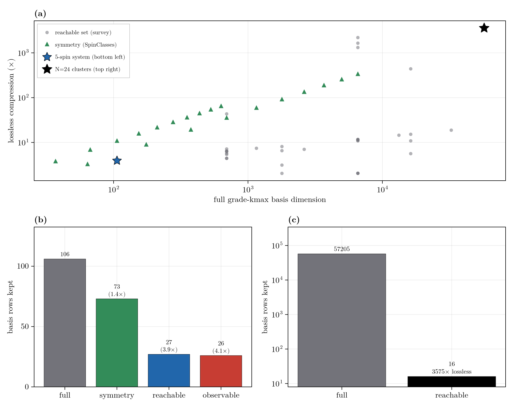

# Reachability, Control, and the Adaptive Basis

```@meta
CurrentModule = RestrictedSpinDynamics
```

The restricted Liouvillian is a linear control system,
``\dot c = \mathcal{L}_0 c + \sum_k u_k(t)\,\mathcal{L}_k c``: a drift generator plus control channels that a
pulse sequence or a [`Modulation`](@ref) switches on. Within a fixed grade ([Grade Truncation and Polynomial
State Space Scaling](@ref)) most strings still carry no amplitude for a given state, observable, and schedule.
Three questions recur: which strings the dynamics can populate, which the measurement can resolve, and when a
truncation loses nothing. The answers are six sets in two dual families (an input side and an output side),
all generated by one algebraic object, the dynamical Lie algebra; a control input enters by enlarging the
input-side orbit from the reachable set to the controllable set. This page defines those sets, shows how pulse
sequences, shaped modulation, and feedback specify the control input, and turns the orbits that input generates
into concrete lossless and lossy basis reductions and the adaptive basis.

## The Dynamical Lie Algebra

The generators of the dynamics are the Hamiltonian terms and the jump operators. Their repeated commutators
span the **dynamical Lie algebra** (DLA): the directions the evolution can generate from any starting point.
The DLA is fixed by the coupling topology rather than the spin count, and it is known before any propagation.

```math
\mathfrak{g} = \langle\, \text{generators} \,\rangle_{\text{Lie}}
= \operatorname{span}\{\, g_i,\ [g_i, g_j],\ [g_i,[g_j,g_k]],\ \dots \,\}.
```

```julia
generators = collect(keys(H))       # the Hamiltonian's Pauli strings (Vector{PauliLabel})
d = dla_dimension(N, generators)    # dimension of the DLA; compare against basis_size(N, k)
```

The three input-side sets below are DLA orbits of a starting state. The three output-side sets are DLA
orbits of an observable under the adjoint. The higher-spin DLA is rank-resolved; see [Higher-Spin](@ref).

## System-Theoretic Sets

Which strings matter within the grade is a linear-systems question, with three levels on each of two dual
sides. The **input side** asks which strings the dynamics populate from the state; the **output side** mirrors
it under the adjoint ``\mathcal{L}^{\dagger}``, asking which strings reach the measurement.

- **Reachable / observable** (the basic pair). The reachable set is the smallest ``\mathcal{L}``-invariant
  subspace containing the state's support, so no amplitude leaves it and restricting to it is exact. Its dual
  is the ``\mathcal{L}^{\dagger}``-invariant subspace containing the observable's support. Their intersection,
  the strings on a path from state to observable, is the smallest basis exact for ``\langle O(t)\rangle``.
- **Controllable / reconstructable** (driven, or read from the past). Drives enlarge the reachable set to the
  controllable set, flooded structurally because the schedule is known ahead. Reading the record from the past
  instead of the future gives the reconstructable set; ``e^{t\mathcal{L}}`` is invertible, so for a continuous
  generator it coincides with the observable set.
- **Stabilizable / detectable** (stability-relaxed). A string the control cannot reach is harmless if it
  decays on its own, so relaxation lets such transients drop out of the basis. This Kalman relaxation is the
  case that bites: over a finite window the modes with negative real part fall below threshold and truncation
  drops them. [`stabilizable`](@ref) and [`detectable`](@ref) report a graded verdict on the complement block
  ``\mathcal{Q}\mathcal{L}\mathcal{Q}`` (experimental, dense).

| Set | Side | What it holds | Hook |
|:---|:---|:---|:---|
| Reachable | input | strings populated from ``c_0`` | [`reachable_basis`](@ref) |
| Controllable | input, driven | strings the drives can populate | [`reachable_basis`](@ref), [`reachable_bases`](@ref) |
| Stabilizable | input, stability | controllable, or uncontrollable and decaying | [`stabilizable`](@ref) |
| Observable | output | strings that influence ``\langle O\rangle`` | [`observable_basis`](@ref) |
| Reconstructable | output, past | present strings pinned by past output | = [`observable_basis`](@ref) (continuous time) |
| Detectable | output, stability | observable, or unobservable and decaying | [`detectable`](@ref) |

The stability-relaxed level is the systems reading of the [Nakajima-Zwanzig Formalism](@ref) Markovian limit:
the kernel coupling the discarded subspace back decays with the spectrum of ``\mathcal{Q}\mathcal{L}\mathcal{Q}``,
so a stable discarded subspace keeps the memory short. The two sides meet in the **minimal realization**, the
strings that are both reachable and observable; it is the smallest basis that carries signal from ``c_0`` to
``\langle O\rangle``, and the pruning below computes it.

```@docs
stabilizable
detectable
```

The next three sections specify the control input, a pulse sequence or a shaped modulation, that fixes the
controllable set; the sections after that turn that input into reachability-based reductions and the adaptive
basis.

## Piecewise-Constant Sequences

The simplest control is a train of intervals, each with a constant Hamiltonian: a hard [`pulse`](@ref) applies
a strong resonant field for a fixed time, a [`delay`](@ref) applies only the drift, and an [`acquire`](@ref)
samples an observable under the drift. A pulse of flip angle ``\theta`` driven at Rabi frequency ``\omega_1``
lasts ``\theta/\omega_1``:

```math
H_{\text{pulse}} = H_0 + \omega_1 \sum_s I_x^{(s)}, \qquad \theta = \omega_1\,\tau .
```

Dissipation, when present, acts identically in every interval. Transverse pulses populate the transverse
plane and break any longitudinal-sector symmetry, so a driven problem must carry a full or banded basis
rather than a fixed sector. The [`sequence`](@ref) composer assembles a `Vector{`[`Segment`](@ref)`}` that
[`propagate_sequence`](@ref) runs, here a spin echo (excite, evolve, refocus, acquire):

```julia
N = 2
b  = restricted_basis(N, N)
Hd = hamiltonian(zeeman(N, [0.0, 10.0]), jcoupling(N, 1, 2, 5.0))
c0 = state(b, polarized(1:N, :z))

seq = sequence(N, Hd,
               pulse(1:N; θ = pi/2, label = "90x"),
               delay(0.05),
               pulse(1:N; θ = pi, label = "180x"),
               acquire(0.05); ω1 = 2pi * 1e4)

r = propagate_sequence(b, seq, c0; jumps = Tuple{PauliDict,Float64}[],   # no relaxation (empty jump list)
                       observables = ["mx" => total_spin_op(N, :x)])
```

`r` returns the concatenated `ts`/`traces`, per-segment `boundaries`, `drift`, the full `trajectory`, and
`final_state`. The Lindblad `jumps` act in every segment.

```@docs
Segment
sequence
pulse
delay
acquire
propagate_sequence
```

## Shaped Modulation

Smoothly shaped control replaces the piecewise-constant train with a generator affine in a set of
time-dependent control amplitudes. Each channel is a fixed unit-strength generator ``\mathcal{L}_k`` scaled by
an envelope ``u_k(t)``, and the realized flip angle of a channel is the integral of its envelope:

```math
\mathcal{L}(t) = \mathcal{L}_0 + \sum_k u_k(t)\,\mathcal{L}_k, \qquad \theta_k = \int u_k(t)\,dt .
```

A constant envelope recovers the static Liouvillian exactly, since the generator is linear in each amplitude.
The [`modulation`](@ref) layer builds ``\mathcal{L}(t)`` from [`drive`](@ref)s and [`propagate_modulation`](@ref)
steps it.

Two families of envelope cover most experiments. **Amplitude shapes** hold the carrier on resonance and sculpt
the pulse profile: [`gaussian`](@ref) and [`sech_envelope`](@ref) for smooth selective excitation,
[`hann_window`](@ref) and [`sinc_envelope`](@ref) for band-selective profiles, and [`sinusoid`](@ref) for a
plain cosine amplitude. **Frequency sweeps** move the effective field through resonance for broadband,
``B_1``-robust inversion: [`tanh_sweep`](@ref) is the bare sweep, and the composite builders
[`adiabatic_drive`](@ref) (hyperbolic-secant, the HS/sech adiabatic-passage inversion) and
[`chirp_drive`](@ref) (linear or WURST amplitude-modulated chirp) emit the matched amplitude and phase
channels together. An adiabatic inversion over 20 ms:

```julia
mod = modulation(N, Hd, adiabatic_drive(N, 1:N; t0 = 0.0, T = 0.02,
                                        ω1max = 2pi*500, bandwidth = 2pi*1000)...)
r = propagate_modulation(b, mod, c0, 0.0:1e-4:0.02;
                         observables = ["mz" => total_spin_op(N, :z)])
```

```@docs
Modulation
modulation
drive
propagate_modulation
```

```@docs
gaussian
sech_envelope
hann_window
sinc_envelope
sinusoid
tanh_sweep
adiabatic_drive
chirp_drive
```

## State-Dependent Feedback

Feedback makes a control amplitude a function of the live state rather than a prescribed function of time, so
the generator is not known in advance and the stepper is nonlinear and closed-loop. Wrap an envelope in
[`Selective`](@ref) to read the live state through [`observe`](@ref) each step, which routes
[`propagate_modulation`](@ref) to the nonlinear closed-loop stepper, here a drive whose amplitude tracks the
transverse magnetization:

```julia
Sx = total_spin_op(N, :x)
fb = drive(Sx, Selective((t, ctx) -> 0.1 * real(observe(ctx, Sx))); label = "feedback")
r  = propagate_modulation(b, modulation(N, Hd, fb), c0, 0.0:1e-3:0.05;
                          observables = ["mx" => Sx])
```

```@docs
Selective
observe
```

The mean-field RASER self-drive (radiation damping), where the transverse magnetization drives itself, is the
canonical case. It is a short recipe over [`drive`](@ref) + [`Selective`](@ref) + [`total_spin_op`](@ref), kept
out of the exported API so you can adapt the convention (sign, axes, subset of spins), realizing
``H_{\text{rd}}(t) = \Gamma\,[\langle S_y\rangle\,S_x - \langle S_x\rangle\,S_y]``:

```julia
function raser_self_drive(N, spins; rate)
    Γ = float(rate)
    Sx = total_spin_op(N, 1; spins = spins)
    Sy = total_spin_op(N, 2; spins = spins)
    return [drive(Sy, Selective((t, ctx) -> -Γ * real(observe(ctx, Sx))); label = "rd-y"),
            drive(Sx, Selective((t, ctx) ->  Γ * real(observe(ctx, Sy))); label = "rd-x")]
end
```

Splat it into [`modulation`](@ref) and run with [`propagate_modulation`](@ref). This is the grade-1 mean-field
(semiclassical) limit of the collective dissipator ``\Gamma\,D[S^+]``: exact at ``k_{\max}=1``, but it conserves
the collective dipole ``|M|`` and omits the grade-``\ge 2`` dissipative back-action. For the full dissipative
RASER use the linear collective jump `dissipator([(collective_pm(N, spins, +1), Γ)])` at sufficient grade. The
loop is nonlinear, so its fixed points, stability, and self-oscillation threshold need the linearization in
[Nonlinear Analysis](@ref) below.

## Reachability as a Lossless Reduction

The reachable set is closed under the generator, so the truncated evolution on it reproduces the
grade-``k_{\max}`` result exactly on a smaller basis. Two variants exist: the forward closure, exact for the
full state; and its intersection with the set that can reach a chosen observable backward, exact for that
observable and typically smaller, since a subsystem that never influences the observable is discarded.

```julia
rb = reachable_basis(N, kmax, H, (b, c0); jumps = jumps)                 # forward closure
rd = reachable_basis(N, kmax, H, (b, c0); jumps = jumps,
                     observables = obs, direction = :observable)             # observable-informed
norm(leakage_block(keepset_leakage(N, kmax, H, jumps, rb.labels)))       # == 0 certifies losslessness
```

`direction = :observable` selects the observable-backward (destination-state-screening) intersection (see
[References](@ref)): it keeps only strings on a path from the initial state *to* one of the requested
`observables`, rather than the full forward closure.

The reductions are lossless (observable error below 1e-12) and they stack with structural symmetry
([`SpinClasses`](@ref) / [`PointGroup`](@ref), see [Symmetry Capabilities](@ref)) and with grade truncation.
On a real 5-spin SABRE system with two magnetically equivalent protons (a mu2-bridge hydride pair relayed to a
15N pyrazine substrate), that equivalence plus observable-informed reachability gives ~4x at grade 2; an ensemble of eight weakly-coupled 3-spin clusters
(N=24) read through a local observable collapses 57,205 rows to 16, a 3575x lossless compression that carries
over to the higher-spin basis.



Lossless compression across many systems. **(a)** Compression versus full basis dimension, keyed to the two
spotlights below. **(b)** The reduction stack on a 5-spin system. **(c)** A disconnected-cluster ensemble
(N = 24).

Reachable (input) basis:

```@docs
support_labels
reachable_labels
reachable_basis
keepset_leakage
```

Observable (output) basis:

```@docs
observable_labels
observable_basis
```

## Control-Informed Reachability

A drive is what turns the reachable set into the controllable set. When the schedule is prescribed in advance,
the control input is a concrete object, the [`Modulation`](@ref) or `Segment` sequence built above, and the
controllable set it generates can be flooded structurally and offline, without ever tracking the state. Feeding
that object to the reachability analysis is the seam between the control layer and the systems theory here.

A [`Modulation`](@ref) is flooded as the union of the drift and every drive generator, so one basis is exact
for every envelope the schedule might carry:

```jldoctest
julia> using RestrictedSpinDynamics

julia> N, kmax = 2, 2;

julia> b = restricted_basis(N, kmax);

julia> Hd = hamiltonian(zeeman(N, [0.0, 10.0]), jcoupling(N, 1, 2, 5.0));

julia> c0 = state(b, polarized(1:N, :z));

julia> mod = modulation(N, Hd, adiabatic_drive(N, 1:N; t0 = 0.0, T = 0.02,
                                               ω1max = 2pi*500, bandwidth = 2pi*1000)...);

julia> rb = reachable_basis(N, kmax, mod, (b, c0));

julia> length(rb) <= length(b)     # the schedule-reachable sub-basis, exact for any envelope
true
```

A `Segment` sequence is instead flooded segment by segment: each interval carries the reachability closure
under its own generator, so a hard pulse's basis includes the strings its drive activates while a delay's does
not. [`reachable_bases`](@ref) returns that per-segment schedule, and [`propagate_sequence_adaptive`](@ref)
carries a basis that grows and shrinks across the sequence, materializing only the strings each segment
populates. This is the offline, schedule-known counterpart of the online adaptive basis below: both track the
reachable frontier, but a prescribed schedule lets each segment's support be computed ahead of time rather than
discovered from the live state.

```@docs
reachable_bases
propagate_sequence_adaptive
```

## Krylov Stepping and the Adaptive Basis

The propagator is matrix-free: each step applies the sparse superoperator to the coefficient vector,
``\mathcal{L}c``, and never forms ``\mathcal{L}`` as a matrix. Because the coupling terms change grade by at
most one, a single ``\mathcal{L}c`` spreads amplitude at most one grade outward, so the Krylov subspace the
stepper builds,

```math
\mathcal{K} = \operatorname{span}\{\, c_0,\ \mathcal{L}c_0,\ \mathcal{L}^2 c_0,\ \dots \,\},
```

grows the reachable set one grade per matrix-vector product. It is the smallest ``\mathcal{L}``-invariant
subspace containing ``c_0``, the reachable set revealed step by step.

A fixed grade cap is therefore usually wasteful: most retained strings never enter ``\mathcal{K}``. The
adaptive basis follows the frontier instead, starting from a small basis and regrowing toward the reachable set
as amplitude spreads, so the full grade-``k_{\max}`` Liouvillian is never built if the support has not
saturated. Growth is lossless only if it outpaces the spreading: if the dynamics reach more shells in a step
than growth adds, the overshoot lands outside the current basis and is discarded. Gently coupled systems stay
exact with a single growth shell; stiff systems need more, checked against a reachability run. When the
instantaneous support instead contracts, as under relaxation, the basis follows it down. The active front
regrown each step is the set of rows above a relative threshold,

```math
\mathcal{F}(t) = \bigl\{\, i : |c_i(t)| > \texttt{tol}\cdot\lVert c(t)\rVert \,\bigr\}.
```

[`propagate_adaptive`](@ref) adds the strings that have just acquired amplitude (the Krylov frontier,
`grow_hops` grades ahead) and, with `drop = true`, removes those that have decayed, so the retained basis
tracks the populated support rather than a static grade shell. The matrix-free matvec is what makes this cheap:
enlarging the basis costs one more sparse application, not a rebuild of a dense generator.

```julia
r = propagate_adaptive(b1, H, c1, ts; observables = obs, kmax = 3, grow_hops = 2)   # grow
r = propagate_adaptive(b1, H, c1, ts; observables = obs, kmax = 3, drop = true)     # grow and shrink
```

The static reachability sets above are the a-priori form of the same idea, and the adaptive basis is their
dynamic realization along the Krylov path. The exactness floor, the grade at which the reachable set stops
growing, and its cross-topology validation are in [The Exactness Floor](@ref).

```@docs
propagate_adaptive
```

## Lossy Pruning and Its Meters

Thresholded pruning discards rows below a cutoff and is lossy by construction, so it carries an error
estimate; the two available estimates diverge sharply. The worst-case operator norm of the boundary block is
a supremum over all states and can be large even when the observable is reproduced exactly. The
trajectory-weighted boundary flow, evaluated along the actual state, is the quantity that bounds the realized
error:

```math
\lVert \mathcal{Q}\mathcal{L}\mathcal{P}\rVert \quad\text{(worst case)}
\qquad\text{versus}\qquad
\Phi(t) = \lVert \mathcal{Q}\mathcal{L}\,\rho(t)\rVert \quad\text{(this run)} .
```

[`zero_track_elimination`](@ref)'s default criterion drops rows whose amplitude stays near zero. An
observable-aware criterion ([`track_importance`](@ref)) instead weights each row by the product of its forward
amplitude and its adjoint sensitivity ``s_i``, giving the bound
``\bigl|\delta\langle O\rangle\bigr| \lesssim \sum_i a_i\,s_i`` derived in [Nakajima-Zwanzig Formalism](@ref)
("the kernel as the error").

```julia
z = zero_track_elimination(b, H, c0, ts; observables = obs, tol = 1e-4)
z.residual_flow.peak     # state-weighted flow along this run (trustworthy)
z.residual_leakage       # worst-case operator norm (pessimistic)
```

**Online versus offline.** The adjoint sensitivity ``s_i`` requires propagating the observable backward from
the final time. A two-pass offline method has the whole trajectory, so this estimate is exact; an online
method deciding during forward integration has only the past, so a per-step backward estimate is myopic and
can discard a row that feeds the observable later. Consequently the online adaptive drop uses the causal
amplitude signal, and the observable-aware criterion is confined to offline elimination.

Automated whole-ladder tiering ([`grade_tiers`](@ref) / [`grade_reduce`](@ref)) assigns each grade shell a
reduction tier from its complement spectrum; the figures of merit and the tier meanings are in
[Nakajima-Zwanzig Formalism](@ref).

```@docs
zero_track_elimination
track_importance
grade_tiers
grade_reduce
```

## Nonlinear Analysis

Everything above is linear systems theory, but the feedback loop is nonlinear: a `Selective` gain makes the
generator depend on the live state, ``\dot c = \mathcal{L}(c)c``. The bridge is linearization.
[`fixed_point`](@ref) finds a self-consistent steady state ``c^{*}`` of the loop, and [`linearize`](@ref)
returns its Jacobian ``\mathcal{L}_{\mathrm{eff}}`` at ``c^{*}``, an effective linear Liouvillian on which
every set and spectrum above applies locally. The reachable and observable sets of
``\mathcal{L}_{\mathrm{eff}}`` are the local controllable and observable directions of the loop; its
eigenvalues are the local growth rates, and a fixed point is stable exactly when they all have negative real
part (the conserved trace mode aside).

[`feedback_threshold`](@ref) turns that into a sweep: as a control parameter varies it tracks the fixed point,
linearizes, and reports where the leading eigenvalue crosses zero, the onset of the mean-field instability
(for the RASER self-drive, the burst threshold). The mean-field loop is itself a projection: the grade-1
self-drive is the ``\mathcal{P}`` = grade-1 projection of [Nakajima-Zwanzig Formalism](@ref), and the
grade-``\ge 2`` dissipative back-action it omits is exactly that projection's memory kernel.

```@docs
linearize
fixed_point
feedback_threshold
```

## Average Hamiltonian Design

Multiple-pulse sequences (WAHUHA, MREV) are designed by their zeroth-order average Hamiltonian: the
toggling-frame Hamiltonian averaged over one cycle, tuned so the unwanted interaction averages to zero,

```math
\bar H^{(0)} = \frac{1}{T}\sum_k \tau_k\,\tilde H_k,
```

with ``\tilde H_k`` the drift in the toggling frame of the ``k``-th interval and ``\tau_k`` its duration. The
[Average Hamiltonian (AHT)](@ref) submodule (experimental,
[Public API & stability](@ref "V1 Public API & Stability")) builds the toggling-frame averages ``\tilde H_k``
and optimizes the inter-pulse windows ``\tau_k`` on small dense operators so the zeroth-order average
vanishes; the grade-truncated engine then validates the design:

```jldoctest
julia> using RestrictedSpinDynamics.AHT

julia> Ix, Iy, Iz = spin_operators(2);

julia> H = Iz[1] * 10.0 + Iz[2] * (-10.0);        # a chemical-shift difference to refocus

julia> p90x = hard_pulse(Ix, Iy, 1:2, 0.0; β = pi/2);

julia> Hs = toggling_frame(H, [p90x, p90x]);

julia> τ = optimize_windows(Hs, fill(1.0, length(Hs)));

julia> maximum(abs, average_hamiltonian(Hs, τ)) < 1e-2     # the shift is averaged away
true
```

## A Full 2D Experiment: Strychnine NOESY

The piecewise-constant machinery scales to a complete, phase-cycled 2D experiment on a real molecule. The
`noesygpph` NOESY program (`90x - t1 - 90x - [z-filter] - mixing (d8 = 400 ms) - 90x - acquire(t2)`, with
States quadrature in F1) runs on 22-spin strychnine across an experiment-matched `256 x 1024`
grid. The drift is first-principles: PBE0 chemical shifts as rotating-frame offsets plus the DFT scalar-
coupling network, so the indirect and direct dimensions carry genuine chemical-shift evolution and
J-multiplet structure. The z-filter is applied as a mask that keeps only longitudinal order (Pauli strings
with zero transverse support), and the mixing time is propagated under dipolar relaxation alone: ideal
Solomon cross-relaxation. Every feature of the spectrum comes from propagating the spin system.


Strychnine 2D NOESY from first-principles DFT shifts and couplings. **Left:** experiment (IMSERC AVANCE 400,
CDCl3, noesygpph, 400 ms mixing). **Center:** RSD pulse-sequence simulation, magnitude mode (pseudo-echo
window). **Right:** the same, phase-sensitive States (pedestal-Gaussian window, blue positive / red negative).
Both sims 256x1024, reproducing the diagonal, the J-multiplet structure, and the dipolar cross-peaks (the
small-molecule direct NOEs are negative, opposite the diagonal).

The plumbing is gated against the trusted relaxation physics: on a strychnine subcluster the sequence
transfer ratios reproduce the Solomon `exp(-R*tmix)` matrix to `6.9e-4`, the `t1` encoding is a cosine,
and grade 2 and grade 3 agree to about one percent (see [Validation](validation.md)). The full run stays
stable across the entire program (excitation, indirect evolution, gradient filter, 400 ms of relaxation
mixing, and detection), producing a spectrum whose J-multiplet fine structure comes from the propagated
couplings.

### Reproducing

The drift is first-principles. The ``^1``H chemical shifts come from an [ORCA](@ref ref-orca) PBE0 shielding
calculation and the scalar-coupling network from a DFT SSCC run; those feed a [`SpinSystem`](@ref) on which the
full `noesygpph` program is propagated (States quadrature in `F1`, a `256 x 1024` experiment-matched grid). The
DFT-input generation, the parsers, and the 2D sequence driver live in the repository's `scripts/` tree, and the
sequence transfer is gated against the Solomon `exp(-R t)` relaxation matrix.

!!! note "Post-Processing"
    The engine emits the raw States interferograms (the cosine- and sine-encoded `t1` FID matrices); a
    reprocessing step renders the 2D spectrum from them:

    - zero-order `t2` phase from the `(t1=0, t2=0)` point;
    - States quadrature combination `A_cos + i·A_sin` of the absorption-mode `t2` spectra, Fourier transformed along `t1`;
    - apodization: a pedestal-Gaussian window for the phase-sensitive panel, a centre-peaked pseudo-echo (sine-bell²) for magnitude;
    - a half-dwell first-point scaling of each FID, and zero-filling.

    Peak positions, signs, and intensities are propagated; the window sets only the lineshape.

## Control (GRAPE)

The reachability and controllability sets above say *which* basis a control problem can reach. The optimizer
that acts on it (the GRAPE adjoint-state design of pulse amplitudes, parametric pulse shapes, and structural
parameters) has its own page:
[Control and Pulse Optimization](@ref). The inverse-problem (system-ID + state-estimation) layer that builds
on the same adjoint lives in the [Inference](@ref "Inference (System ID & State Estimation)") submodule.

## Detection Noise

Detection-chain post-processing ([`add_detection_noise`](@ref), [`nyquist_sigma`](@ref)) is pure signal
processing on the recorded traces, never touching propagation.

```@autodocs
Modules = [RestrictedSpinDynamics]
Pages = ["noise.jl"]
Private = false
```

## Relation to Prior Work

These methods descend from the restricted-state-space (SSR) programme of Kuprov and coworkers (the Spinach
lineage) recast in a Pauli-string and dynamical-Lie-algebra frame (see [References](@ref)). The
correspondences are close enough to name term by term:

- **Grade truncation** is their correlation-order / spin-order restriction: keep only product operators of at
  most ``k`` non-identity factors ([Kuprov, Wagner-Rundell, Hore 2007](@ref ref-kuprov-2007)). The exactness axiom is identical: the
  retained set must be closed under the generator, and their "loose ends" that leak out of the space are the
  boundary block ``\mathcal{Q}\mathcal{L}\mathcal{P}`` above.
- **[`reachable_basis`](@ref)** is the symbolic form of their Krylov-subspace view of the trajectory,
  ``\mathcal{K} = \operatorname{span}\{\rho_0, \mathcal{L}\rho_0, \mathcal{L}^2\rho_0, \dots\}`` ([Kuprov 2008](@ref ref-kuprov-2008)):
  we enumerate the *support* of that subspace on the coupling graph, rather than building it numerically by
  Lanczos (which they note goes unstable past a few hundred vectors).
- **[`zero_track_elimination`](@ref)** is their zero track elimination ([Kuprov 2008](@ref ref-kuprov-2008)): probe a trajectory, drop
  rows ("tracks") that stay near zero, and propagate on the reduced operator. The ``\texttt{:observable}``
  intersection and the ``\texttt{:dual}`` importance weight extend it with an observable-backward screen, the
  counterpart of their destination-state screening ([Krzystyniak, Edwards, Kuprov 2011](@ref ref-krzystyniak-2011)).
- **The error meters** instrument the SSR accuracy theory of [Karabanov et al. (2011)](@ref ref-karabanov-2011): their
  per-correlation-order norm ``|\hat\rho_k|^2`` is our trajectory-weighted boundary flow ``\Phi(t)``, and their
  leakage-versus-cutoff bound is the statistical counterpart of the exact algebraic floor from
  [`dla_report`](@ref).

Two things go past that programme. First, **online temporal adaptivity**: their basis is fixed once
precomputed (2007) or reduced once (2008), whereas [`propagate_adaptive`](@ref) grows and shrinks the basis
during propagation. Second, the **system-theoretic framing** of basis selection (reachable, controllable,
observable, reconstructable, and detectable sets), which mirrors the controllability/reachability language
Kuprov's later optimal-control work adopts ([Kuprov 2023](@ref ref-kuprov-2023)), applied here to basis selection.

Next: [Nakajima-Zwanzig Formalism](@ref) keeps the discarded block as a memory kernel instead of pruning it.
