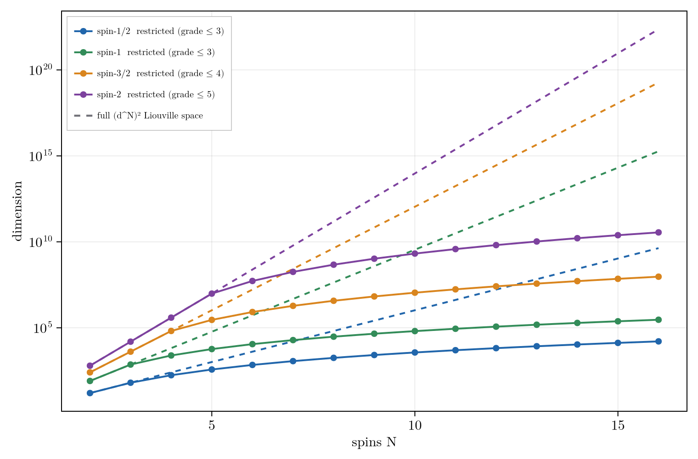

# Grade Truncation and Polynomial State Space Scaling

Grade truncation is the central approximation of the package: it caps the correlation order a state carries,
so systems too large for full Liouville space become tractable.

## Grade as Correlation Order

The density operator is expanded in a basis of **product operators**, tensor products of a single-site
operator over the ``N`` sites. A basis element's **grade** is its number of non-identity factors, which *is*
its **correlation order**: grade one is a single-spin term, grade two a two-spin correlation, up to a fully
``N``-body term. The single-site operators depend on the spin. At spin-``\tfrac12`` they are the four Paulis
``\{I, X, Y, Z\}``, so a product operator is a Pauli string. At dimension ``d = 2S+1`` they are the ``d^2``
spherical tensors (see [Higher-Spin](@ref)). Grade counts non-identity sites in every case. Grade truncation
keeps correlation order at most ``k_{\max}``, so ``k_{\max}`` is the highest order of multi-spin correlation
the model carries.

```math
\rho = \sum_\alpha c_\alpha\, P_\alpha,
\qquad P_\alpha = \bigotimes_{s=1}^{N} O^{(s)}_{a_s},
\qquad g(P_\alpha) = \#\{\,s : a_s \neq 0\,\}.
```

Each ``O^{(s)}_{a_s}`` is a single-site operator (``a_s = 0`` the identity), so ``g`` counts the non-identity
factors.

Keeping ``g\le k_{\max}`` leaves a basis of dimension

```math
D(N,k) = \sum_{g=0}^{k}\binom{N}{g}\,3^{g},
```

so ``D(N,N)=4^N`` is the full Liouville space, while for ``k\ll N`` the dimension is polynomial in ``N`` of
degree ``k``,

```math
D(N,k) \sim \frac{(3N)^{k}}{k!}.
```

The dimension counts above are for spin-``\tfrac12`` (three non-identity operators per site). For a site of
dimension ``d`` there are ``d^2-1`` non-identity operators and the full Liouville space is ``(d^2)^N``, so
replace ``3 \to d^2-1`` and ``4^N \to (d^2)^N`` throughout.

```julia
D = basis_size(N, kmax)              # dimension of the retained basis
b = restricted_basis(N, kmax)        # the basis itself
```

At fixed grade the retained basis grows polynomially in ``N``, with a per-grade prefactor ``(d^2-1)^k``
that rises with the site dimension ``d`` (three operators per spin-1/2 site, eight per spin-1, fifteen per
spin-3/2), so for higher spin the truncated basis is larger at a given grade. The full ``(d^N)^2`` Liouville
space grows exponentially in ``N`` with a base that rises faster still, so the retained fraction is smallest
exactly where the spin is highest, even as the grade needed to reach the floor tends to climb with the spin
manifold.



Grade-truncated basis dimension (solid) versus the full (d^N)^2 Liouville space (dashed), spin-1/2 through
spin-2. The cutoff is k_max = 3 for spin-1/2 and spin-1 and climbs for higher spin; the restricted basis stays
polynomial in N.

## The Gaussian Level

The grade-2 coefficients are the one- and two-point functions, the means ``\langle I_a^{(s)}\rangle`` and the
pairwise correlations ``\langle I_a^{(s)} I_b^{(t)}\rangle``, which are the data of a Gaussian state. If the
dynamics preserved Gaussianity, Wick's theorem would reconstruct every higher correlation from these and grade
``> 2`` would carry no information. The su(2) algebra is nonlinear, so they do not: the equation of motion for a
``k``-body correlation couples to ``(k+1)``-body correlations, an open moment hierarchy that does not close at
order two. Grade truncation drops the discarded correlations rather than Wick-factorizing them, so a grade-2
model is a linear projection onto the Gaussian data (mean field plus fluctuations, the second-cumulant
picture), not a cumulant closure. It is exact when the dynamical Lie algebra closes at grade 2 and otherwise
approximate at the per-grade rate of [The Convergence Rate](@ref). Grade ``> 2`` is the non-Gaussian content.

## The Exactness Condition

Grade-``k_{\max}`` truncation is a projection ``\mathcal{P}`` onto the retained subspace, with complement
``\mathcal{Q}``. Whether that projection discards anything is set at two levels, the generator and the
trajectory.

At the generator level the test is closure. The retained subspace is invariant under ``\mathcal{L}`` when
the generator maps it into itself, which holds when the dynamical Lie algebra built from the Hamiltonian
terms and the jump operators closes at grade ``\le k_{\max}``:

```math
\mathcal{L}\rho = -i[H,\rho] + \sum_j\Big(L_j\rho L_j^\dagger - \tfrac12\{L_j^\dagger L_j,\rho\}\Big),
\qquad \mathcal{Q}\mathcal{L}\mathcal{P} = 0 .
```

When ``\mathcal{Q}\mathcal{L}\mathcal{P} = 0`` the truncated generator reproduces the full dynamics for every
state in the retained subspace and for all time, since ``\mathcal{P}\,e^{\mathcal{L}t}\,\mathcal{P} =
e^{(\mathcal{P}\mathcal{L}\mathcal{P})\,t}``. This closing grade is the exactness floor, a property of the
coupling topology alone.

Closure is sufficient but stronger than a single run requires. A given propagation explores only the
reachable set of its initial state, the span of ``c_0, \mathcal{L}c_0, \mathcal{L}^2 c_0, \dots``. If that
reachable set lies inside ``\mathcal{P}`` the run is exact even when the full algebra does not close at
``k_{\max}``, because the trajectory never populates the strings that would leak. The floor is derived,
tabulated by geometry, and made state-sharp in this reachable sense in [The Exactness Floor](@ref). A direct
certificate from the generator-level DLA size:

```jldoctest
julia> using RestrictedSpinDynamics

julia> H = hamiltonian(zeeman(3, [0.0, 3.0, 7.0]), jcoupling(3, 1, 2, 5.0), jcoupling(3, 2, 3, 5.0));

julia> d = dla_dimension(3, collect(keys(H)))    # strings reachable under nested commutation
30

julia> (d, basis_size(3, 2), 4^3)                # DLA size vs the grade-2 basis vs the full 4^N space
(30, 37, 64)
```

`basis_size(N, kmax)` returns the grade-truncated dimension without building the basis. When the DLA fits
inside a low cutoff that cutoff loses nothing and the truncation is exact.

For an important class of couplings the closing grade is ``N`` itself, so no cutoff below the full space is
exact. Isotropically coupled networks (Heisenberg, ``XX+YY+ZZ``), the regime of strong homonuclear coupling,
and zero- to ultralow-field (ZULF) NMR all mix every correlation order: the algebra fills each grade up to
``N``, and under isotropic coupling the reachable set grows exponentially as well, so even it is large. Grade
truncation is then a convergence-controlled approximation rather than an exact reduction. Validate it against
a small full run and take the saving from symmetry, weight sectors, and reachability rather than from the
grade cutoff alone. See [Zero- and Ultralow-Field (ZULF) Simulations](@ref).

## Convergence Below the Floor

When the cutoff sits below the floor the error behaves in one of two ways. Truncating below a low closing grade
severs the algebra and the failure is qualitative, returning *identically zero* where the signal is large (the
AA'X system at a cutoff of two is the validated gate). When the algebra instead fills every grade, the error is
a geometric tail: each added grade cuts it by a roughly constant factor, so ``k_{\max}`` is a predictable
accuracy/cost dial, and deep truncation does better still, since the tail is factorial and falls faster than
any geometric rate.

That per-grade factor is a structural, gauge-invariant property of the generator: the grade-raising content of
the Liouvillian, read directly from ``\mathcal{L}``. The predictive law ``r \approx \rho/(1+\rho)``, how to
read ``\rho`` at high field versus zero field, and a worked chain are in [The Convergence Rate](@ref).

## Choosing the Cutoff

For a system that does not fit in full space:

1. Compute the closure floor. If the maximum grade reached by the dynamical Lie algebra is small, use it and
   the model is exact.
2. Otherwise converge the observable: increase the cutoff until ``\langle O\rangle(t)`` is stationary to
   tolerance. Local, low-order observables converge at a lower cutoff than global or high-order ones.
3. Bound the discarded flow. The boundary block ``\mathcal{Q}\mathcal{L}\mathcal{P}`` is assembled directly;
   a zero norm certifies exactness for every state and a small norm bounds the worst-case error. The test is
   sufficient, not necessary: a nonzero norm can still leave a given run exact when its reachable set avoids
   the boundary.
4. Prune within the cutoff. Most retained strings carry no amplitude; restrict to the populated support as in
   [Reachability, Control, and the Adaptive Basis](@ref).

A worked example runs the recipe on a common organic motif: two scalar-coupled protons among uncoupled
spectators, an AX pair sitting in a four-spin register. Because the coupling is confined to one pair, the
algebra closes at grade 2 (step 1), and a grade-2 basis reproduces the full-space dynamics while spanning a
quarter of the ``4^N`` Liouville space:

```jldoctest grade-kmax
julia> using RestrictedSpinDynamics

julia> N = 4;      # sites 1-2 share a scalar coupling; sites 3-4 are uncoupled spectators

julia> H = hamiltonian(zeeman(N, 2pi .* [10.0, 40.0, 80.0, 130.0]), jcoupling(N, 1, 2, 2pi*8.0));

julia> dla_report(N, collect(keys(H))).grade_floor    # the algebra closes at grade 2
2

julia> (basis_size(N, 2), 4^N)                        # grade-2 basis vs the full Liouville space
(67, 256)

julia> obs = Dict("iz1" => spin_op(N, 1, :z));

julia> function traj(k)
           b = restricted_basis(N, k)
           propagate(b, build_liouvillian(b, H), state(b, polarized(1, :z)), 0:0.02:0.3;
                     observables = obs, dt = 1e-3).traces["iz1"]
       end;

julia> maximum(abs, traj(2) .- traj(4)) < 1e-9        # grade 2 reproduces the full trajectory
true

julia> maximum(abs, traj(1) .- traj(4)) > 0.02        # grade 1 (mean-field) misses the coupling
true
```

Grade 1 keeps only single-spin order, so it misses the antiphase term the coupling builds and tracks the
site-1 polarization wrongly; grade 2 adds the two-spin correlations the pair needs and is exact (step 2 is
unnecessary here, since step 1 already landed on a cheap exact cutoff). When the coupling is instead extended
and strong, as in the isotropic and ZULF regime above, the floor climbs to ``N`` and step 2 governs the
choice: the error then falls geometrically with the cutoff at the coupling-set rate shown in
[The Convergence Rate](@ref).

[`grade_tiers`](@ref) automates this recipe: under a single `err_tol` knob it assigns each grade shell a tier
(exact, memory, Markovian, or drop) and [`grade_reduce`](@ref) assembles the reduced generator. The figures
of merit, the tier meanings, and a worked example are on the [Nakajima-Zwanzig Formalism](@ref) page.

## See Also

- [The Convergence Rate](@ref): the theory of the per-grade factor ``r`` when the cutoff sits below the floor.
- [Symmetry Capabilities](@ref): exact symmetry sectors (Pauli parity, definite total-``S_z`` weight,
  site-permutation) that compose with the grade cap.
- [Reachability, Control, and the Adaptive Basis](@ref): dynamics-informed basis pruning within the cutoff.
