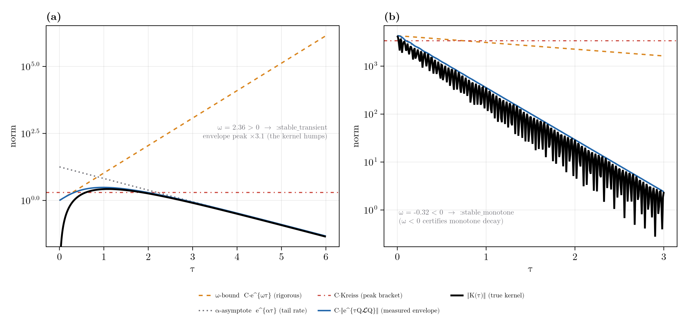

# Nakajima-Zwanzig Formalism

The Nakajima-Zwanzig (NZ) formalism produces the exact closed equation of motion for a chosen part of a
system's state, expressed through a projection superoperator. It is the formal setting for grade truncation
and the reachable-basis restriction: both are choices of projector, and the operator this package calls the
leakage is one factor of the NZ memory kernel. The first three sections develop the theory; the last two
give the correspondence with the code.

## Projection Superoperators

Choose a superoperator ``\mathcal{P}`` that projects Liouville space onto the part of the state to retain,
with complement ``\mathcal{Q}=\mathbb{1}-\mathcal{P}``. A projector satisfies

```math
\mathcal{P}^2 = \mathcal{P}, \qquad \mathcal{Q}^2 = \mathcal{Q},
\qquad \mathcal{P}\mathcal{Q} = \mathcal{Q}\mathcal{P} = 0,
\qquad \mathcal{P} + \mathcal{Q} = \mathbb{1}.
```

The retained and discarded parts of the state are ``\rho_{\mathcal P}\equiv\mathcal{P}\rho`` and
``\rho_{\mathcal Q}\equiv\mathcal{Q}\rho``, so ``\rho=\rho_{\mathcal P}+\rho_{\mathcal Q}``. In the standard
open-systems application ``\mathcal{P}`` projects onto a reference bath state; here it projects onto a set of
retained Pauli strings, either those of grade at most ``k_{\max}`` or a generator-closed reachable set.

## Deriving the Exact Closed Equation

Begin from the Liouville-von Neumann equation ``\dot\rho=\mathcal{L}\rho`` and apply ``\mathcal{P}`` and
``\mathcal{Q}``, inserting ``\mathbb{1}=\mathcal{P}+\mathcal{Q}`` after the generator. This gives two coupled
equations,

```math
\dot\rho_{\mathcal P} = \mathcal{P}\mathcal{L}\mathcal{P}\,\rho_{\mathcal P}
                      + \mathcal{P}\mathcal{L}\mathcal{Q}\,\rho_{\mathcal Q},
```
```math
\dot\rho_{\mathcal Q} = \mathcal{Q}\mathcal{L}\mathcal{P}\,\rho_{\mathcal P}
                      + \mathcal{Q}\mathcal{L}\mathcal{Q}\,\rho_{\mathcal Q},
```

in which the diagonal terms evolve each part within its own subspace and the off-diagonal terms
``\mathcal{P}\mathcal{L}\mathcal{Q}`` and ``\mathcal{Q}\mathcal{L}\mathcal{P}`` couple them. The second
equation is linear and inhomogeneous in ``\rho_{\mathcal Q}`` with source
``\mathcal{Q}\mathcal{L}\mathcal{P}\,\rho_{\mathcal P}(t)``. Solving it by variation of constants, with the
propagator ``e^{\mathcal{Q}\mathcal{L}\mathcal{Q}\,\tau}`` generated within the discarded subspace,

```math
\rho_{\mathcal Q}(t) = e^{\mathcal{Q}\mathcal{L}\mathcal{Q}\,t}\,\rho_{\mathcal Q}(0)
   + \int_0^{t} e^{\mathcal{Q}\mathcal{L}\mathcal{Q}\,(t-s)}\,
     \mathcal{Q}\mathcal{L}\mathcal{P}\,\rho_{\mathcal P}(s)\,ds .
```

Substituting this into the ``\rho_{\mathcal P}`` equation removes ``\rho_{\mathcal Q}`` and yields the
Nakajima-Zwanzig generalized master equation, exact and closed in the retained part:

```math
\dot\rho_{\mathcal P}(t) = \mathcal{P}\mathcal{L}\mathcal{P}\,\rho_{\mathcal P}(t)
   + \int_0^{t}\!\mathcal{K}(t-s)\,\rho_{\mathcal P}(s)\,ds
   + \mathcal{P}\mathcal{L}\,e^{\mathcal{Q}\mathcal{L}\mathcal{Q}\,t}\,\rho_{\mathcal Q}(0),
```

with the memory kernel

```math
\mathcal{K}(\tau) = \mathcal{P}\mathcal{L}\mathcal{Q}\;
                    e^{\mathcal{Q}\mathcal{L}\mathcal{Q}\,\tau}\;
                    \mathcal{Q}\mathcal{L}\mathcal{P} .
```

The three terms are, in order:

1. **Retained evolution** ``\mathcal{P}\mathcal{L}\mathcal{P}\,\rho_{\mathcal P}`` within the kept subspace.
2. **A convolution over the past** through the kernel ``\mathcal{K}``, which sends the state into the
   discarded subspace, evolves it there for a time ``\tau``, and returns it, making the retained dynamics
   non-Markovian.
3. **An initial slip**, the inhomogeneous transient from any amplitude initially outside ``\mathcal{P}``,
   which vanishes when ``\rho_{\mathcal Q}(0)=0``.

## Markovian and Time-Convolutionless Limits

If the kernel decays on a correlation time short compared with the evolution of ``\rho_{\mathcal P}``, the
history integral localises in time,

```math
\int_0^{t}\!\mathcal{K}(t-s)\,\rho_{\mathcal P}(s)\,ds
   \;\approx\; \Big(\!\int_0^{\infty}\!\mathcal{K}(\tau)\,d\tau\Big)\,\rho_{\mathcal P}(t),
```

the Markovian limit; truncating the kernel at second order in the ``\mathcal{P}``-``\mathcal{Q}`` coupling
(the Born approximation) recovers the Redfield and Lindblad dissipators. The kernel decays with the spectrum
of ``\mathcal{Q}\mathcal{L}\mathcal{Q}``, so this limit holds exactly when the discarded subspace is stable,
which is the detectability and stabilizability of the dropped modes in
[Reachability, Control, and the Adaptive Basis](@ref).

Because ``\mathcal{Q}\mathcal{L}\mathcal{Q}`` is non-normal, "stable" here means more than a negative
spectral abscissa: ``e^{\mathcal{Q}\mathcal{L}\mathcal{Q}\,\tau}`` can amplify transiently before it decays,
and while that transient lasts the kernel is not short. The right test is therefore the transient envelope
``\lVert e^{\mathcal{Q}\mathcal{L}\mathcal{Q}\,\tau}\rVert`` and the kernel norm ``\lVert\mathcal{K}(\tau)\rVert``
themselves; the eigenvalues alone miss the transient. [`stabilizable`](@ref) / [`detectable`](@ref) at `level = :transient`
report exactly these: the numerical abscissa (``\omega<0`` certifies monotone decay, no transient), the
two-sided Kreiss bracket ([`RestrictedSpinDynamics.Spectral.kreiss_bracket`](@ref), enclosing
``\sup_\tau\lVert e^{\mathcal{Q}\mathcal{L}\mathcal{Q}\,\tau}\rVert`` between its lower and upper bounds), the measured envelope
([`RestrictedSpinDynamics.Spectral.transient_bound`](@ref)), and the kernel peak and integral
``\int_0^\infty\lVert\mathcal{K}(\tau)\rVert\,d\tau``, a direct measure of how much the discarded subspace
leaks back before it relaxes.



**(a)** On the engineered block the kernel grows transiently to 3.1x before decaying; the numerical abscissa
``\omega>0`` and the Kreiss bracket bound the hump that the spectral abscissa alone would miss
(`:stable_transient`). **(b)** On the physical grade-1 | grade-2 kernel of a collectively-decaying spin system the
numerical abscissa ``\omega<0`` *certifies* monotone decay (`:stable_monotone`). These are the meters behind the
`:memory`-versus-`:markov` tier choice in [Multigrade Tiering](@ref). A complementary exact
rewriting, the time-convolutionless form, expresses ``\rho_{\mathcal Q}(t)`` through ``\rho_{\mathcal P}(t)`` rather than
its history and produces a time-local generator

```math
\dot\rho_{\mathcal P}(t) = \mathcal{G}(t)\,\rho_{\mathcal P}(t),
```

with no convolution: the same content reorganised, and the natural language for a time-dependent generator. It
is also the setting for a state-dependent (feedback) generator, which the projection reaches through its
linearization (see [Reachability, Control, and the Adaptive Basis](@ref)).

## Exactness of Grade Truncation

Grade truncation propagates only the first term of the generalized master equation, discarding the memory
kernel and the initial slip. This is exact precisely when the kernel vanishes, which by the form of
``\mathcal{K}`` holds if and only if no flow crosses the boundary, ``\mathcal{Q}\mathcal{L}\mathcal{P} = 0``.
A generator-closed keep-set (a [`reachable_basis`](@ref), certified by [`keepset_leakage`](@ref)) satisfies
the same condition. This is the exactness floor; its derivation, the closing-grade table, and the
`leakage_block` certificate are in [The Exactness Floor](@ref).

## The Kernel as the Error

When ``\mathcal{Q}\mathcal{L}\mathcal{P}\neq 0`` the discarded kernel is the error. Its magnitude along the
actual trajectory, weighted by the current state, is

```math
\Phi(t) = \lVert \mathcal{Q}\mathcal{L}\,\rho(t)\rVert ,
```

a per-run indicator, in contrast to the worst-case operator norm
``\lVert \mathcal{Q}\mathcal{L}\mathcal{P}\rVert``. For a specific observable ``O``, a discarded string
contributes to ``\langle O(t)\rangle`` only if it lies on a path from the initial support to ``O`` (the
forward-reachable set intersected with the set backward-reachable from ``O``), and to first order the induced
error is bounded by a sum over discarded strings of the forward amplitude ``a_i`` times the adjoint
sensitivity ``s_i``,

```math
\bigl|\delta\langle O\rangle\bigr| \lesssim \sum_{i\in\mathrm{discarded}} a_i\, s_i .
```

The state-weighted flow and the observable-aware bound are the meters and the dual criterion of the
truncation tools:

```julia
Phi = leakage_flow(m, c)                                   # state-weighted boundary flow at state c
z   = zero_track_elimination(b, H, c0, ts; observables = obs)   # reports both meters; dual criterion uses a_i s_i
```

See [Reachability, Control, and the Adaptive Basis](@ref) for the reachability and pruning machinery this bounds.

## Reduced Dynamics: Effective Generator and Memory Kernel

Beyond bounding the error, the projection also runs forwards as a reduction. [`effective_liouvillian`](@ref) builds the
Markovian (``s=0``) limit of the generalized master equation on a kept sub-basis: the Schur complement

```math
\mathcal{L}_{\mathrm{eff}} = \mathcal{P}\mathcal{L}\mathcal{P}
   - \mathcal{P}\mathcal{L}\mathcal{Q}\,(\mathcal{Q}\mathcal{L}\mathcal{Q})^{-1}\,\mathcal{Q}\mathcal{L}\mathcal{P}
   = \mathcal{P}\mathcal{L}\mathcal{P} + \tilde{\mathcal{K}}(0),
```

adiabatically eliminating the fast complement, exact for the stationary and slow dynamics (the ``P``-part of
the full stationary state is annihilated by ``\mathcal{L}_{\mathrm{eff}}``).

The full non-Markovian kernel is propagated by [`memory_kernel`](@ref). Because the restricted Liouvillian is
finite-dimensional, the Laplace-domain kernel

```math
\tilde{\mathcal{K}}(s) = \mathcal{P}\mathcal{L}\mathcal{Q}\,(s - \mathcal{Q}\mathcal{L}\mathcal{Q})^{-1}\,\mathcal{Q}\mathcal{L}\mathcal{P}
```

is exactly *rational*, with poles at the eigenvalues of ``\mathcal{Q}\mathcal{L}\mathcal{Q}``. The route
[`memory_kernel`](@ref) takes: (1) partition into the ``P``/``Q`` sub-blocks, as
[`effective_liouvillian`](@ref) does; (2) read the pole/residue form of ``\tilde{\mathcal{K}}(s)`` by
diagonalizing (or block-Schur, guarding non-normality with the [Spectral (Contour)](@ref) `eigstructure` /
`petermann_factor` tools) ``\mathcal{Q}\mathcal{L}\mathcal{Q}``, exact with all poles, or reduced to the
dominant (slowest, largest-residue) ones; (3) embed each retained pole as one auxiliary memory block, the
same local embedding the post-Markovian [`pome`](@ref) uses for its single exponential mode; and (4) step the
enlarged generator with the ordinary [`propagate`](@ref) `expv` stepper, no new time-stepping machinery. A
contour-Laplace (Bromwich) inversion of ``[\,s - \mathcal{P}\mathcal{L}\mathcal{P} - \tilde{\mathcal{K}}(s)\,]^{-1}``,
built from the Spectral resolvent quadrature, is the independent correctness check, and
[`effective_liouvillian`](@ref) is the single-term (pole-free) limit of this construction.

The **time-convolutionless** alternative ([`tcl_generator`](@ref), Breuer & Petruccione Ch. 9.2) trades the
memory convolution for a compact time-LOCAL generator
``K(t) = \mathcal{P}\mathcal{L}\mathcal{P} + \mathcal{P}\mathcal{L}\mathcal{Q}\,M(t)\,\mathcal{Q}\mathcal{L}\mathcal{P}``,
``M(t) = \int_0^t e^{\mathcal{Q}\mathcal{L}\mathcal{Q} s}\,ds``, on the kept subspace alone, no pseudomode
embedding. It interpolates ``K(0) = \mathcal{P}\mathcal{L}\mathcal{P}`` and ``K(\infty) =``
[`effective_liouvillian`](@ref). To second order in the coupling it is accurate for weak leakage, but at strong
coupling it shows the characteristic TCL breakdown (the generator turns unstable and the propagation diverges)
where the exact [`memory_kernel`](@ref) should be used instead.

All three share the same `(basis, L, kept)` call and the same `P`/`Q` partition (keep a grade-1 sub-basis,
eliminate the grade-2 complement):

```jldoctest nz-reductions
julia> using RestrictedSpinDynamics

julia> b = restricted_basis(2, 2);

julia> L = build_liouvillian(b, hamiltonian(jcoupling(2, 1, 2, 5.0)); jumps = decay(2, 1:2, 0.7));

julia> kept = restricted_basis(2, 1);           # keep grade 1, eliminate grade 2

julia> eff = effective_liouvillian(b, L, kept);         # Markovian (s=0) Schur fold

julia> (length(eff.basis), size(eff.L))
(7, (7, 7))

julia> mk = memory_kernel(b, L, kept);                  # exact non-Markovian: one block per pole of QLQ

julia> (mk.nP, length(mk.poles))
(7, 9)

julia> tcl_generator(b, L, kept).nP                     # time-local TCL2 on the kept subspace
7
```

Each returns something [`propagate`](@ref) steps directly (`eff.L`, the `MemoryKernel`, the `TCLGenerator`),
so swapping reductions is a one-line change in the propagation call.

## Strong-Coupling Strategy

Strong coupling inverts the usual accuracy-cost tradeoff. One expects a strongly coupled complement to demand
the exact memory kernel; when that complement is also *fast*, the opposite holds. The cheap Markovian
reductions become both the more accurate and the better-conditioned choice, and the exact kernel is the one
that turns stiff.

Write ``\Gamma`` for the decay rate of the discarded subspace (the spectral-abscissa magnitude of
``\mathcal{Q}\mathcal{L}\mathcal{Q}``) and ``J`` for the coherent coupling that mixes it with the retained part
(the scale of the boundary operator ``\mathcal{Q}\mathcal{L}\mathcal{P}``). In the spin example that threads
this guide, ``\Gamma`` is the bath spin's decay rate and ``J`` its scalar coupling to the retained spin. Their
ratio ``J/\Gamma`` is the Born-Markov smallness parameter, and the strong-coupling regime is a *fast*
complement, ``J/\Gamma \ll 1``.

There the Markovian and adiabatic reductions are expansions in ``J/\Gamma``, so they grow *more* accurate as
``\Gamma`` rises, and the generators they fold stay small and well-conditioned. The full and exact-memory
generators instead turn **stiff**, their eigenvalues spanning ``\Gamma`` down to the motionally-narrowed
``J^2/\Gamma``, which strains the `expv` stepper and forces its dense ``\exp`` fallback. The cheap reductions
are the accurate and the comfortable choice at once. Reach for them in this order:

- [`effective_liouvillian`](@ref) is the ``\Gamma \to \infty`` limit by construction (the ``s=0`` Schur fold),
  so it is accurate exactly when the complement is fast, and its ``\mathcal{L}_{\mathrm{eff}}`` is a small,
  non-stiff superoperator.
- [`adiabatic_elimination`](@ref) is the Hilbert-space companion. It folds a fast-decaying *manifold* rather
  than a grade block, inverting the no-jump Hamiltonian [`no_jump_hamiltonian`](@ref) on that manifold to
  second order in the coupling. `space = :hilbert` returns a composable GKSL ``(H, \mathrm{jumps})``;
  `space = :liouville` returns the exact-Markovian superoperator. In a timescale-separated system its error
  falls the fastest with ``J/\Gamma``, making it the most accurate non-exact option.
- [`memory_kernel`](@ref) stays exact, but its pseudomode embedding places poles at the fast
  ``\mathcal{Q}\mathcal{L}\mathcal{Q}`` eigenvalues, so the enlarged generator is stiff and the Krylov `expv`
  step can fail on it. Propagate it densely (``\exp(\mathcal{M}t)``; the blocks are small once the complement
  is folded) or keep only the dominant poles when the exact curve is needed at strong coupling.
- [`tcl_generator`](@ref): avoid here. The time-local second-order generator goes unstable in exactly this
  regime (the TCL breakdown noted above).

Two regime-specific caveats follow from motional narrowing. The induced retained rate scales as
``J^2/\Gamma`` and so *decreases* as the complement gets faster, which makes the retained dynamics
**long-lived** at strong coupling. First, a reduction's small error in that rate or amplitude then accumulates
over the longer window, so the late-time error can grow with ``\Gamma`` even while the transient (peak) error
shrinks. Second, the Markovian reductions drop ``\rho_{\mathcal Q}(0)``, and the resulting slow-mode amplitude
offset now persists for the full long lifetime; seed it with `complement0` on [`memory_kernel`](@ref) when it
matters, or accept the offset. Only the exact kernel is immune to both, which is precisely when its stiffness
is most inconvenient.

## Multigrade Tiering

[`effective_liouvillian`](@ref) (Markovian, ``s=0``) and [`memory_kernel`](@ref) (full memory) are the two
extremes of a single choice applied to the *whole* complement. But the complement is itself graded, and
because the Liouvillian is grade-banded (two-spin couplings shift the correlation order by ``\le 1``,
dissipators by ``\le 2``) it can be peeled shell by shell from the outermost grade inward. Each shell can take
a different tier (kept **exact**, kept with **memory**, folded in **Markovian**-ly, or **dropped**) and
[`grade_tiers`](@ref) chooses them automatically from per-shell figures of merit, with [`grade_reduce`](@ref)
assembling the result (``=`` [`effective_liouvillian`](@ref) on the Markovian shells ``\circ``
[`memory_kernel`](@ref) on the memory shells).

For shell ``g`` with block ``\mathcal{L}_{gg}`` and inner retained space ``S`` (grades ``< g``), define:

- **Relevance** ``w_g = \lVert \mathcal{L}_{Sg}\,\mathcal{L}_{gg}^{-1}\,\mathcal{L}_{gS} \rVert / \lVert \mathcal{L}_{SS}\rVert``,
  the normalized ``s=0`` Schur-return weight (the second-order Schrieffer-Wolff smallness parameter
  ``\sim \lVert\text{coupling}\rVert^2/(\text{gap}\cdot\text{inner rate})``). Small ``w_g`` ``\Rightarrow`` the
  shell barely affects the kept dynamics even at Markovian order ``\Rightarrow`` **drop**.
- **Non-Markovianity index** ``\eta_g = \gamma_{\mathrm{ref}}/\lvert\alpha_g\rvert``, the Born-Markov small
  parameter, the ratio of the shell memory time ``\tau_g = 1/\lvert\alpha_g\rvert`` (``\alpha_g`` the shell
  spectral abscissa) to the system timescale ``1/\gamma_{\mathrm{ref}}`` (``\gamma_{\mathrm{ref}}`` the fastest
  core mode). With the non-normal correction ``\eta_g\,T_g`` (``T_g`` the shell transient peak), ``\eta_g T_g
  \ll 1 \Rightarrow`` the shell relaxes fast on the kept timescale ``\Rightarrow`` **Markovian** is accurate;
  otherwise keep **memory**.
- **Guards**: ``\alpha_g \ge 0`` (an undamped mode) forces **exact**; ``\omega_g \ge 0`` or a large ``T_g``
  (strong non-normality, the ``s=0`` proxy unreliable) forces **memory**. Here ``\omega_g`` is the shell
  numerical abscissa and ``T_g`` its [`RestrictedSpinDynamics.Spectral.transient_bound`](@ref) peak.

Normalizing each ``w_g`` by the total complement weight makes the single knob `err_tol` a dimensionless
fraction of the complement's influence: peeling outward-in, each shell takes the coarsest admissible tier
(drop ``<`` Markovian ``<`` memory ``<`` exact in cost) that keeps the running budget below `err_tol`, yielding
three cutoffs ``k_{\text{exact}} \le k_{\text{memory}} \le k_{\text{markov}}``. The budget `err_est` is a
*monotone indicator* of the observable error, not a strict bound (static operator-norm proxies cannot bound a
trajectory tightly); `err_tol`` \to 0`` recovers the full dynamics exactly, and the scale is calibrated per
system by comparing [`grade_reduce`](@ref) against the full run.

An initial state that populates the **memory** region is handled by the Nakajima-Zwanzig inhomogeneity
``I(t) = \mathcal{P}\mathcal{L}\mathcal{Q}\,e^{\mathcal{Q}\mathcal{L}\mathcal{Q} t}\,\rho_Q(0)`` (Breuer &
Petruccione, Ch. 9): in the pole embedding it is one extra scalar mode per pole, ``\dot p_j = \lambda_j p_j``,
seeded at ``p_j(0) = u_j^{\mathsf T}\rho_Q(0)`` and fed to ``\rho_P`` through ``\mathcal{P}\mathcal{L}\mathcal{Q}
v_j``, activated by passing `complement0` to [`propagate`](@ref). So ``\rho_Q(0)=0`` is **not** required: only
population in the Markovian/dropped region (which has no memory modes) is lost, so the exact core need only
cover what is read (the observables), not the full initial support.

With a localized seed and a grade-1 observable, the exact core is just grades 0-1 and the complement peels
into the memory tier automatically:

```jldoctest nz-tiering
julia> using RestrictedSpinDynamics

julia> H = hamiltonian(zeeman(3, [0.0, 1.0, 2.0]), jcoupling(3, 1, 2, 5.0), jcoupling(3, 2, 3, 5.0));

julia> b = restricted_basis(3, 3);

julia> c0 = state(b, polarized([1], :z));               # localized, low-grade seed

julia> obs = Dict("Iz1" => spin_op(3, 1, 3));           # grade-1 observable sets the exact core

julia> t = grade_tiers(3, 3, H, (b, c0); jumps = decay(3, 1:3, 0.8), observables = obs);

julia> t.tiers                                           # grade 0..3: exact core, complement -> memory
4-element Vector{Symbol}:
 :exact
 :exact
 :memory
 :memory

julia> grade_reduce(3, 3, H, (b, c0); jumps = decay(3, 1:3, 0.8), observables = obs) isa MemoryKernel
true
```

Tightening `err_tol` grows the exact core (toward the full dynamics); loosening it lets more shells fold
Markovian-ly or drop. Calibrate it by comparing [`grade_reduce`](@ref) against a full-basis run on a short
window.

## Relation to Relaxation Theory

Applying the same split to a bath rather than a grade cap is the standard derivation of the relaxation
backends: take ``\mathcal{P}`` the projector onto the system and a reference bath state, expand the kernel to
second order (Born) and localise it in time (Markov), and it becomes the Redfield or Lindblad dissipator;
retaining the kernel to all orders for a classical bath is the stochastic-Liouville route. [Relaxation
Backends](@ref) presents that construction from the bath side; this is the same algebra from the truncation
side.
