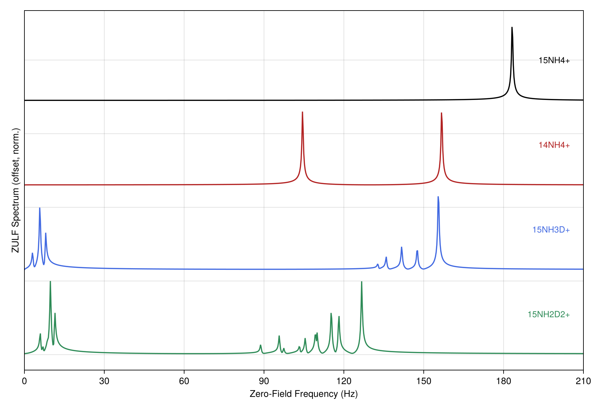

# Zero- and Ultralow-Field (ZULF) Simulations

At zero to ultralow field (nanotesla to roughly millitesla), the nuclear Zeeman interaction is comparable to or
weaker than the J-couplings, so the high-field ordering inverts: `J ≳ |Δω|`. The high-field approximations that
general NMR simulation relies on fail here, each with its own ZULF replacement.

## The High-Field Assumptions and Their Replacements

At high field `ω_0 ≫ J`, so every coupling is a perturbation on the Zeeman term. At ZULF that ordering inverts
and each high-field shortcut breaks:

| High-field assumption | Fails because | ZULF replacement |
|:---|:---|:---|
| Secular coupling (`ising`, `ZZ` only) | the coupling rivals the shift dispersion | full isotropic [`jcoupling`](@ref) |
| Total-`S_z` eigenspaces | Zeeman no longer dominates | total-spin `F` / permutation symmetry |
| Zeeman-secular relaxation | the eigenbasis is the coupling's | eigenbasis [`redfield_jumps`](@ref) |
| RWA (Tavis-Cummings) | collective `g` rivals `ω_0` | keep the counter-rotating terms |

The eigenstates are now the full coupling Hamiltonian's (the singlet/triplet manifold of a pair, total spin
`F` for a group), so which transitions appear follows the total-spin states, not high-field selection rules.

## Full Isotropic Couplings

Use the full isotropic coupling [`jcoupling`](@ref) (`2π J I_i·I_j = 2π J (XX + YY + ZZ)/4`), not the secular
[`ising`](@ref) (`ZZ` only). The secular truncation that makes `ising` valid requires `|Δω| ≫ J`, which fails
at ZULF: at zero field a J-coupled pair is a singlet/triplet system, and only the full dot coupling captures
the singlet/triplet mixing that drives the dynamics.

```julia
using RestrictedSpinDynamics

N = 2
H = hamiltonian(jcoupling(N, 1, 2, 5.0))          # 2π·5 Hz isotropic coupling; NOT ising
basis = restricted_basis(N, N)                    # strong coupling populates grade 2, so keep it
L = build_liouvillian(basis, H)
c0 = state(basis, singlet(1, 2))                  # parahydrogen singlet order
res = propagate(basis, L, c0, 0.0:0.01:1.0; observables = ["S" => singlet_op(N, 1, 2)])
```

Add [`zeeman`](@ref) with small offsets for a residual or guiding field. Homonuclear spins stay strongly
coupled down to zero field; a large heteronuclear `Δγ` can decouple partially, where the dominant-field
relaxation presets regain some validity. Strong coupling spreads population across correlation orders, so a
ZULF system needs a higher grade than its high-field equivalent; validate with a full (`kmax = N`) run at small
`N` before truncating (see [Grade Truncation and Polynomial State Space Scaling](@ref)).

## Total-Spin and Zero-Quantum Sectors

With isotropic couplings and no field, the Hamiltonian commutes with the total spin, so the dynamics stay in a
definite total-coherence sector. Two exact reductions capture this, both keywords of [`restricted_basis`](@ref)
(see [Basis & Symmetry](@ref)):

- **Coherence order** (`weight`): a ladder basis of definite `Σ q`. Parahydrogen singlet order and the
  low-field transfer it drives live in the zero-quantum (`weight = 0`) block, a large exact saving. The
  symmetry-based ZULF-SABRE framework of [Markelov, Snadin, Kiryutin, Barskiy, Yurkovskaya (2026)](@ref ref-markelov)
  uses the total-spin symmetry shared by the Hamiltonian, relaxation, and exchange to
  restrict rigorously to exactly this zero-quantum subspace, scaling to a 14-spin complex.
- **Site permutation** (`symmetry`): magnetically equivalent spins fold onto [`SpinClasses`](@ref) orbits; a
  group of `n` identical spins collapses to a dimension independent of `n`.

Together these keep multi-spin ZULF problems tractable.

The two reductions behave differently under a pulse. A transverse field or *ramp* changes coherence order by
±1, so it leaves the `weight`/parity sector (exact only for a static, longitudinal Hamiltonian). A uniform
pulse is permutation-invariant, so the `symmetry` (total-spin) reduction survives it, carried through exactly
by [`propagate_sequence`](@ref) / [`propagate_modulation`](@ref). For the coherence structure under a drive,
drop `weight` and prune with the schedule-aware reachable basis ([`reachable_basis`](@ref) /
[`propagate_sequence_adaptive`](@ref); see [Reachability, Control, and the Adaptive Basis](@ref)).

## Relaxation in the Coupling Eigenbasis

The relaxation model is where ZULF most often goes wrong. The Zeeman-secular backends (the Solomon dipolar,
CSA, and scalar rates behind [`DipolarRelaxation`](@ref) / [`CSARelaxation`](@ref) / [`ScalarRelaxation`](@ref))
assume `ω_0 ≫` coupling and take the secular approximation in the Zeeman frame; at ZULF that frame is wrong, so
those rates are wrong. Use [`redfield_jumps`](@ref) instead: it diagonalizes the full coherent Hamiltonian and
builds the jumps in *its* eigenbasis, so the secular approximation is taken where the eigenstates actually are.

```julia
A = [spin_op(N, 1, 3), spin_op(N, 2, 3)]          # system-bath coupling operators (here I_z on each spin)
jumps = redfield_jumps(H, A, BPP(1e-9), N)        # eigenbasis Redfield, τc = 1 ns; method = :davidovic (CP)
L = build_liouvillian(basis, H; jumps = jumps)
```

`method = :davidovic` (default) is completely positive by construction; `:nathan_rudner` is the non-secular
Universal Lindblad form. Both reduce to the ordinary secular result for well-separated frequencies, so one
model stays correct as you sweep the field from high to zero.

To read a rate rather than propagate, feed `L` to [`initial_rate`](@ref) (the `T1`/`T2` slope, or a
cross-relaxation-matrix row for a vector of observables), sweep it with [`rate_vs_field`](@ref), or take the
fixed point with [`steady_state`](@ref). There is no closed-form ZULF rate the way [`solomon_rates`](@ref)
gives the high-field `σ`/`ρ`; at ZULF it is read numerically from the eigenbasis-Redfield generator. Stay on
the eigenbasis-Redfield rung or above; see [Relaxation Backends](@ref) for the full taxonomy.

## Higher-Spin Nuclei at Zero Field

Many ZULF-relevant nuclei are not spin-1/2. Deuterium (²H) and nitrogen (¹⁴N) are spin-1, and their
quadrupolar coupling is an electric-field-gradient interaction independent of the applied field. At zero field
it sets the dominant energy scale rather than perturbing the Zeeman term, and the high-field secular picture
breaks the same way the coupling one does. Keep the full quadrupolar term ([`quadrupole`](@ref) /
[`quadrupole_hamiltonian`](@ref)) rather than a secular truncation. Set the spin dimension with the `radix`
keyword (or derive it from the isotopes with a [`SpinSystem`](@ref)); the composers each take a `radix`:

```julia
d = [3, 2]                                            # a spin-1 (d = 3, e.g. ²H) coupled to a spin-1/2
basis = restricted_basis(2, 2; radix = d)
H = hamiltonian(jcoupling(2, 1, 2, 5.0, d),           # isotropic J, the full dot coupling as above
                quadrupole(2, 1, d; nu_q = 2π*50.0))  # field-independent quadrupolar term on the spin-1
jumps = relaxation_jumps(QuadrupolarRelaxation([1], 2π*0.5; ω0 = 2π*1.0, τc = 5e-2), 2, d)
L = build_liouvillian(basis, H; jumps = jumps)
c0 = state(basis, polarized(1, :z; m = 0.1), mixed(2))
```

Quadrupolar relaxation uses the closed-form [`QuadrupolarRelaxation`](@ref) model (channel builder
[`quadrupole_relaxation`](@ref)) at high field, or, for the non-secular ZULF regime, the eigenbasis
[`redfield_jumps`](@ref) route, which
takes tensor operators and a `radix` for spin ``\ge 1`` (thermalized [`davies_jumps`](@ref) and
[`kossakowski_matrix`](@ref) cross-correlation carry over too). See [Higher-Spin](@ref) for the tensor
conventions and the rank-resolved DLA.

## The Ammonium Isotopologue Series

Full isotropic couplings, the zero-quantum sector, and total-spin symmetry together produce the zero-field
spectrum of a real system; the ammonium isotopologues are the worked example. The only parameter is the
one-bond coupling `1J(15N,1H) = -73.3 Hz`, from which every other coupling follows by the exact isotope
relation `J(X,Y) = J0 (γX γY)/(γ15N γ1H)`. Each ion is prepared in proton order and read out at zero field as
the OPM signal `Σ γ_i ⟨Iz_i⟩`; its Fourier transform is the J-spectrum.



Each isotopologue carries a fingerprint set by its symmetry and spins. The fully symmetric `15NH4+` (four
equivalent protons on a spin-1/2 nitrogen) is dominated by a single line near `2.5|J|`. Replacing `15N` with
spin-1 `14N` moves and splits the pattern toward `2|J|` and `3|J|`, and each deuteration lowers the proton
symmetry and adds the smaller `N-D` and `H-D` couplings, so `15NH3D+` and `15NH2D2+` break into progressively
richer multiplets. The spin-1 `14N` and `2H` route automatically to the higher-spin tensor basis, and the
spectra are exact (full grade).

The worked computation takes one isotopologue (`15NH3D+`). A vector OPM records all three local components. At
zero field the coupling is isotropic: with proton z-order only Mz oscillates (the J-spectrum) and the
transverse components stay zero. A small z-guiding field and a proton pi/2 excitation (the *ultralow* in ZULF)
tip the order into the plane, so all three then carry signal.

```julia
using RestrictedSpinDynamics
G = RestrictedSpinDynamics.ISOTOPE_GAMMA
jbond(a, b) = -73.3 * (G[a] * G[b]) / (G["15N"] * G["1H"])    # one-bond J from the isotope relation

iso = ["15N", "1H", "1H", "1H", "2H"]                         # 15NH3D+; the 2H (spin-1) routes to the tensor basis
N   = length(iso)
cpl = [(1, 1 + k, jbond(iso[1], iso[1 + k])) for k in 1:4]
ss  = SpinSystem(iso; shifts = zeros(N), couplings = cpl)     # zero shifts = zero field
b   = restricted_basis(ss, N)                                 # full grade = exact
rad = spin_radix(ss)
c0  = state(b, polarized(2:N, :z))                            # proton order, dropped from high field
opm(ax) = reduce((u, v) -> mergewith(+, u, v),                # OPM component along ax: γ-weighted collective I_ax
                 Dict(p => ss.gammas[i] * c for (p, c) in spin_op(N, i, ax, rad)) for i in 1:N)

# zero field: only Mz is live -> the J-spectrum
sz = propagate(b, build_liouvillian(b, hamiltonian(ss)), c0, 0:2e-3:4;
               observables = ["Mz" => opm(:z)]).traces["Mz"]

# ultralow field: a z-guiding field (~50 Hz proton Larmor) + a proton pi/2 pulse put signal on all three axes
su = SpinSystem(iso; couplings = cpl, shifts = [G[x] * 1.17e-6 / 2pi for x in iso])
Bp = pi / (2 * G["1H"] * 2.5e-4)                              # hard proton pi/2 about x, over 0.25 ms
Hx = reduce((u, v) -> mergewith(+, u, v),
            Dict(p => ss.gammas[i] * Bp / 2pi * c for (p, c) in spin_op(N, i, :x, rad)) for i in 1:N)
cp = propagate(b, build_liouvillian(b, Hx), c0, [0, 2.5e-4];
               observables = ["Mz" => opm(:z)], save_trajectory = true).trajectory[end]
vec = propagate(b, build_liouvillian(b, hamiltonian(su)), cp, 0:2e-3:4;
                observables = ["M$ax" => opm(ax) for ax in (:x, :y, :z)])
```

Each spectrum is `abs.(rfft(·))`. At zero field `sz` holds the J-spectrum and the transverse components stay
zero. At ultralow field the transverse pair coincide (circular precession about the guiding field), so the
figure plots their magnitude `sqrt(Mx^2 + My^2)` over the longitudinal `Mz`:


The two figures and their data (`data/zulf_spectra/ammonium.csv` for the zero-field series and
`ammonium_vector.csv` for the vector readout) back the two panels above.

## Strong Collective Coupling

This is the RWA replacement applied to a collective term. At ZULF the individual spin frequencies are small, so
collective effects that are negligible at high field can dominate. Many spins coupling to a shared mode (a
tuned detection coil through radiation damping, a common reservoir in collective SABRE) can rival or exceed the
spin frequencies, the strong and then ultrastrong regime where RASER and superradiance live: `N` spins behave
as one giant spin with the coupling concentrated in the symmetric bright state (a `√N` enhancement). The
package exposes the collective operators ([`collective_pm`](@ref), [`total_spin_op`](@ref)), the collective
leakage channel ([`superradiance_leakage`](@ref)), and the radiation-damping / RASER self-drive as a
state-reading [`drive`](@ref) + [`Selective`](@ref) gain stepped by [`propagate_modulation`](@ref). The regime
is numerically demanding on two fronts:

- **Keep the full coupling and a sufficient grade.** Once `g ~ ω_0` the counter-rotating terms carry real
  frequency shifts that the Tavis-Cummings truncation drops, and strong collective coupling builds high-order
  correlations fast, so the DLA may not close: check [`dla_report`](@ref) and lean on [`SpinClasses`](@ref)
  symmetry.
- **Read stability and the lasing threshold off the right tools.** These Liouvillians are strongly non-normal,
  so use the transient tools of [Spectral (Contour)](@ref) rather than an eigendecomposition, and locate the
  nonlinear RASER onset with [`fixed_point`](@ref) / [`linearize`](@ref) / [`feedback_threshold`](@ref).

## Field Cycling and SABRE

Field ramps (field cycling, SABRE-SHEATH, level-anti-crossing transfer) and parahydrogen-to-substrate SABRE
are field-manipulation and chemical-exchange techniques rather than ZULF simulation specifics. Ramp `B(t)` with
[`propagate_timedep`](@ref) and [`field_ramp`](@ref), stepping finely enough to resolve an anti-crossing; drive
SABRE as a two-compartment dissolution / re-association network built from [`exchange`](@ref) edges (see
[Chemical Exchange & Stochastic Liouville](@ref)). A ramp breaks the `weight` sector, so keep only the
`symmetry` reduction through it, or restrict per piecewise-constant segment. To map transfer against field (a
SABRE-SHEATH or level-anti-crossing profile), sweep the generator with [`sweep_field`](@ref) and a
[`steady_state`](@ref) readout: `make_L(B)` rebuilds the `J`-coupled drift with its field-dependent Zeeman plus
the exchange jumps at each point.
