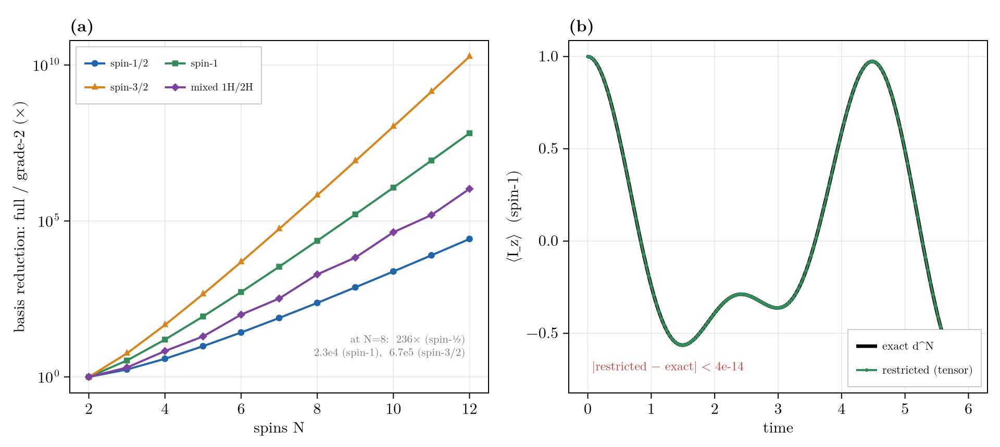
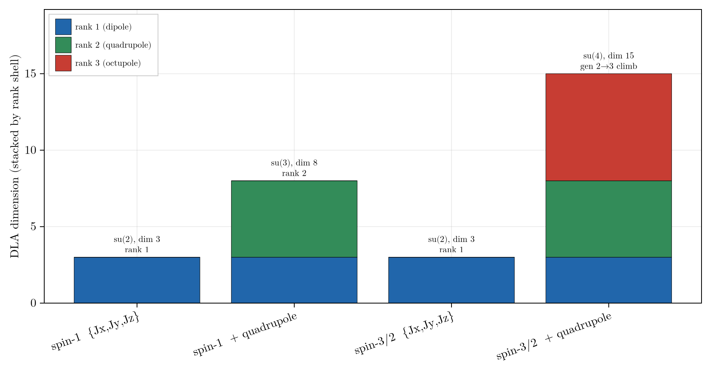

# Higher-Spin

Higher-spin (spin > 1/2) support is a full, validated surface reached through the **same entry points** as
spin-1/2 (`restricted_basis(...; radix)`, `hamiltonian`, `state`, `spin_op`, ...): basis and algebra,
Liouvillian and propagation, the named terms and state constructors, relaxation, grade truncation, symmetry,
and reachability are all in place and checked to machine precision against exact `d^N` references.

The spin-1/2 engine represents `ρ = Σ c_α P_α` in a grade-truncated basis of Pauli strings. Higher spin
generalizes the per-site alphabet to the `d^2` irreducible spherical tensors of a dimension-`d = 2S+1` site
(the [spherical-tensor encoding](@ref "Spherical-Tensor Strings"), whose product is a *sum* of strings, so the
Liouvillian stays sparse). Heterogeneous ("mixed radix") systems are supported: each site carries its own
dimension `d_s`, so a real `1H + 2H + 14N` molecule lives in one basis, with trace scaling
`hilbert_dim = ∏_s d_s`.

A site of dimension ``d`` carries ``d^2-1`` operators (3 for spin-1/2, 8 for spin-1, 15 for spin-3/2), so a
grade-2 basis is absolutely *larger* at fixed grade, yet the full ``(d^N)^2`` space grows so much faster that
grade-2 is a far smaller *fraction* of it (the ``N=8`` basis-size reduction: ``236\times`` for spin-1/2,
``2.3\times10^4`` for spin-1, ``6.7\times10^5`` for spin-3/2). Grade truncation is *lossy*, exact only when
the dynamical Lie algebra closes at grade 2 (the rank-ladder section below); the *lossless* reductions are
symmetry and reachability. A spin-1 quadrupolar nutation is non-sinusoidal because the
``\pm1\leftrightarrow0`` transitions are quadrupole-detuned (no spin-1/2 analogue), and the restricted tensor
run reproduces it to machine precision; exactness across spin-1, spin-3/2, and mixed radix is gated in
`validate_higher_spin.jl` (worst ``1.4\times10^{-15}``).



## Convention

[`spin_matrix`](@ref)`(d, axis)` returns the angular-momentum operator `I_a` (`Jx`/`Jy`/`Jz`/`J±`) as a
dense `d × d` matrix. At `d = 2` this equals `σ_a/2`, so it matches the spin-1/2 `spin_op` convention
exactly: **a higher-spin term built from the named composers reduces to the corresponding Pauli term at
`d = 2`**. That identity is the single most useful sanity check when writing higher-spin code.

## Specifying the System

For a real molecule, name the **isotopes**, not the raw dimensions: a [`SpinSystem`](@ref) reads each
site's spin from [`ISOTOPE_SPIN`](@ref) (`2H`, `14N` -> spin-1, ...) and the basis derives its `radix`
automatically. The count form is the terse way in:

```jldoctest higherspin
julia> using RestrictedSpinDynamics

julia> ss = SpinSystem("1H" => 2, "14N" => 1);         # two protons + one 14N (spin-1)

julia> basis = restricted_basis(ss, 2);                # radix derived from the isotopes; none typed

julia> (basis.radix, hilbert_dim(basis))
([2, 2, 3], 12.0)
```

`restricted_basis(ss, kmax)` and `simulate(ss, ...)` route to the tensor path whenever any site has
`d > 2`; add `shifts`/`couplings`/`coords`/`csa` to the [`SpinSystem`](@ref) for the actual dynamics.
Reach for the raw `radix` keyword only to set spins directly: a toy model, or a spin the isotope table
does not cover.

## The Idiomatic Workflow

Set the spin once (via a [`SpinSystem`](@ref) or the `radix` keyword) and the ordinary composers and
verbs do the rest, the same `restricted_basis -> hamiltonian -> state -> build_liouvillian -> propagate`
pipeline as spin-1/2:

```jldoctest higherspin
julia> using RestrictedSpinDynamics

julia> d, N = 3, 2;                                    # two spin-1 sites

julia> basis = restricted_basis(N, N; radix = d);      # unified entry point (radix = [3, 3])

julia> (length(basis), hilbert_dim(basis))             # operator-basis rows, and d^N
(81, 9.0)

julia> H = hamiltonian(zeeman(N, [1.3, -0.7], d),      # composable named terms; each takes a `radix`
                       jcoupling(N, 1, 2, 0.5, d),
                       quadrupole(N, 1:N, d; nu_q = 0.8));   # rank-2, no spin-1/2 analogue

julia> jumps = relaxation_jumps(QuadrupolarRelaxation([1, 2], 2π*0.5; ω0 = 2π*1.0, τc = 5e-2), N, d);

julia> L = build_liouvillian(basis, H; jumps = jumps);

julia> c0 = state(basis, pure(1, :up), mixed(2));      # site 1 pure |m = +1>, site 2 maximally mixed

julia> round(real(expect(basis, c0, total_spin_op(N, :z, d))); digits = 3)   # <Iz> = +1 (site 1) + 0
1.0

julia> round(real(purity(basis, c0)); digits = 4)      # pure (x) maximally-mixed-spin-1 (1/3)
0.3333

julia> res = propagate(basis, L, c0, 0.0:0.5:5.0; observables = Dict("Iz" => total_spin_op(N, :z, d)));

julia> real(res.traces["Iz"][end]) < 1.0              # quadrupolar relaxation pulls <Iz> down
true
```

## Best Practices

- **Use the entry points, not the `tensor_*` constructors.** For a molecule, build a
  [`SpinSystem`](@ref) from its isotopes and let `restricted_basis(ss, kmax)` derive the `radix`; set it
  by hand with `restricted_basis(N, kmax; radix = d)` (a scalar, or a `[d_1, ..., d_N]` vector) only for a
  toy model. [`spin_tensor_basis`](@ref) is the lower-level form both delegate to.
- **Compose Hamiltonians with the named terms.** [`zeeman`](@ref), [`jcoupling`](@ref), [`ising`](@ref),
  [`xy`](@ref), [`dipolar`](@ref), [`drive_field`](@ref), and [`csa`](@ref) each take a trailing `radix`;
  [`quadrupole`](@ref) is the rank-2 term with no spin-1/2 analogue (needs `d ≥ 3`); it is field-independent
  and dominates at low field, so it is central to higher-spin work in [Zero- and Ultralow-Field (ZULF)
  Simulations](@ref). Reach for [`tensor_op`](@ref) + [`spin_matrix`](@ref) only for an operator the named
  terms do not build.
- **Prepare states with `state(...)`.** [`pure`](@ref)`(s, :up/:x/…)` is a genuine spin-S coherent state, and
  [`polarized`](@ref)/[`mixed`](@ref)/[`bloch`](@ref) are the linear (high-temperature) *dipole*
  product states; for the higher multipoles a spin > 1/2 site carries, [`aligned`](@ref) sets rank-2
  quadrupolar order and [`multipole`](@ref) a general spherical-tensor population. These per-site terms compose
  over disjoint sites, so mixed-spin prep is one call. [`coupled_state`](@ref) prepares a correlated `|S,M⟩`
  eigenstate of a coupled subset, and [`tensor_state`](@ref)`(basis, site_mats)` takes a raw per-site density
  matrix directly.
- **Read out with the radix observables.** [`spin_op`](@ref)`(N, s, axis, radix)`,
  [`total_spin_op`](@ref)`(N, axis, radix)`, [`expect`](@ref), and [`purity`](@ref) all dispatch on the
  tensor basis.
- **Exploit the exact reductions; they all compose with `radix`:**
  - `weight = w` restricts to the coherence-order sector when the dynamics conserves `S_z`
    ([`build_liouvillian`](@ref) throws via `check_sector_closure` if a term leaks weight).
  - `symmetry = PointGroup(...)` / `SpinClasses(...)` for magnetically equivalent (equal-spin) sites.
  - [`reachable_basis`](@ref)`(..., (basis, c0); jumps, observables, direction = :observable)` prunes to the
    generator/observable-informed keep-set (lossless, zero boundary leakage).

  Grade truncation (`kmax < N`) is the one *lossy* reduction; validate its closure with [`dla_report`](@ref).
- **Use mixed radix for real molecules.** One basis holds a `1H + 2H` (`[2, 3]`) or `1H + 14N` system;
  `hilbert_dim = ∏_s d_s`, and every trace factor routes through it.
- **Relaxation composes through `dissipator(...)`** just like the coherent terms: the channel builders
  (`decay`/`pump`/`dephasing`/`thermal_relaxation`, `dipolar_relaxation`, `csa_relaxation`,
  `scalar_relaxation`, and the second-kind variants) each take a trailing `radix`. The one exception is
  [`QuadrupolarRelaxation`](@ref) (spin ≥ 1, no composer wrapper); build it with
  `relaxation_jumps(model, N, radix)`.
- **Regression-check at `d = 2`.** Any tensor construction must reproduce its Pauli twin exactly when every
  site is spin-1/2, a cheap, decisive test while developing.

## Composable Reductions

All the basis reductions carry over and compose (the Best Practices above list the radix forms). Grade
truncation is the only *lossy* one, exact iff the DLA closes at grade ``\le k_{\max}`` (the rank ladder
below); the radix basis, its exactness floor, and the equal-dimension symmetry caveat are documented on the
[Basis & Symmetry](@ref) page.

## Dynamical Lie Algebra and the Rank Ladder

The exactness floor ([The Exactness Floor](@ref)) carries over, but its computation changes: a tensor
commutator is a *sum* of spherical tensors, so the DLA is a genuine subspace closed by a span rather than a
set of strings. The tensor [`dla_dimension`](@ref)`(N, generators, radix)` and [`dla_report`](@ref) compute it
(see [Basis & Symmetry](@ref)).

Higher spin adds an axis absent at spin-1/2: **multipole rank** (each site carries `T^k_q`, `k = 1..2S`).
`dla_report` resolves the algebra by rank as well as grade. Commutators can *climb* the rank ladder
(`[rank-2, rank-2]` opens rank-3), so on spin-3/2 a quadrupolar (or merely `J`-coupled) Hamiltonian generates
octupolar (rank-3) order, `rank_ceiling > gen_rank`; on spin-1 (max rank 2) the ladder is capped.

On a single site the rank-`k` shell is the `(2k+1)`-dimensional multipole multiplet: `{Jx,Jy,Jz}` closes to
`su(2)` (rank 1); adding the quadrupole opens rank 2 and fills `su(3)` on spin-1, while on spin-3/2 it climbs
to rank 3 and fills `su(4)`. `simulate(...; dla = true)` prints the grade-floor and rank-ceiling on the
higher-spin path.



## API

The spherical-tensor encoding and its operators ([`SpinTensorLabel`](@ref), [`spin_matrix`](@ref),
[`tensor_op`](@ref)) are on the [Pauli, Ladder & Tensor Algebra](@ref) page, and the radix
basis ([`spin_tensor_basis`](@ref), [`hilbert_dim`](@ref), [`dla_report`](@ref)) on
[Basis & Symmetry](@ref). The higher-spin-only quadrupole terms live with their peers: the coherent
[`quadrupole`](@ref) / [`quadrupole_hamiltonian`](@ref) on [Hamiltonian Terms](@ref), and the dissipative
[`QuadrupolarRelaxation`](@ref) / [`quadrupole_relaxation`](@ref) on [Relaxation & Dissipators](@ref). The
per-site state constructor is here:

```@docs
tensor_state
```

The coherent named terms ([`zeeman`](@ref), [`jcoupling`](@ref), [`ising`](@ref), [`xy`](@ref),
[`dipolar`](@ref), [`csa`](@ref), [`drive_field`](@ref)), the state constructors ([`state`](@ref),
[`pure`](@ref), ...), the observables ([`spin_op`](@ref), [`total_spin_op`](@ref), [`expect`](@ref),
[`purity`](@ref)), and the relaxation models all gain higher-spin methods via a `radix` argument; the tensor
methods of [`build_liouvillian`](@ref), [`expect`](@ref), and [`reachable_basis`](@ref) live with their
spin-1/2 twins.
