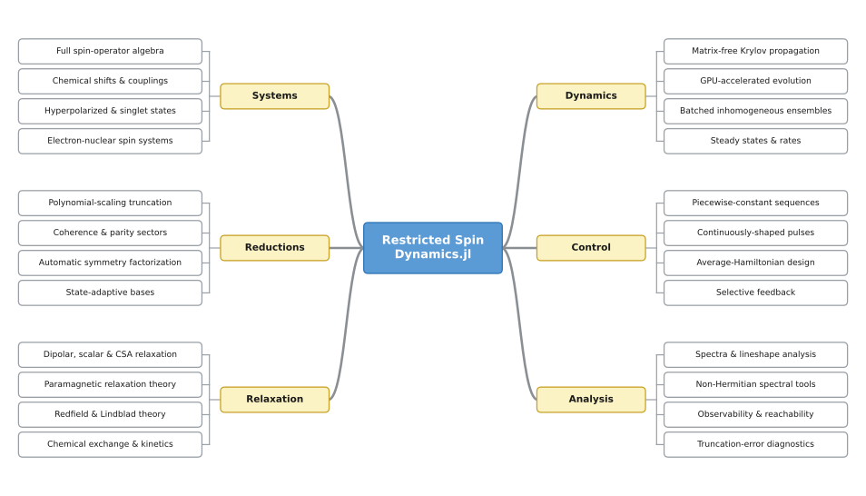
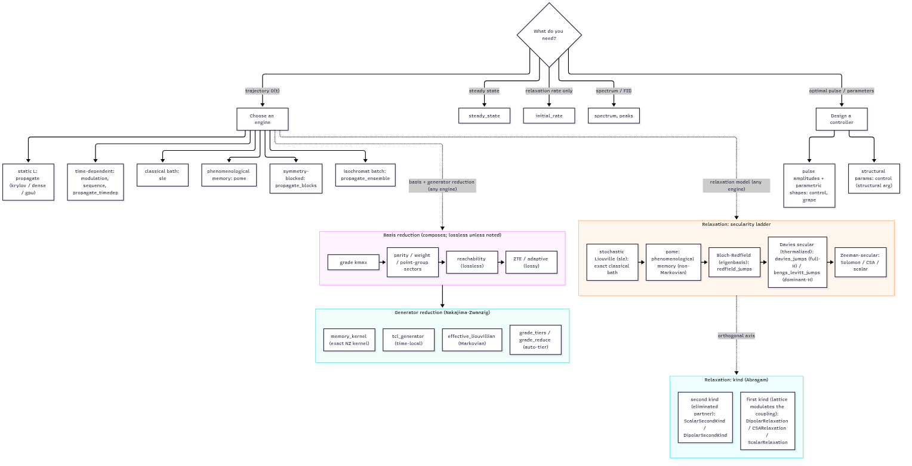

# RestrictedSpinDynamics.jl



RestrictedSpinDynamics.jl simulates open-system NMR spin dynamics for systems far larger than a full Liouville-space treatment can reach, and it runs on an ordinary workstation. It handles coupled spin systems, pulse sequences, and relaxation.

The [Getting Started](@ref) guide installs the package and runs two worked simulations, a free induction decay and a pulse sequence. For a longer hands-on path, the `scripts/tutorials/` directory has seven numbered, runnable walkthroughs.

It reaches that scale at polynomial cost in the number of spins. The density matrix `ρ = Σ c_α P_α` is expanded in a product-operator string basis (Pauli strings for spin-1/2, irreducible spherical tensors for higher spin) truncated by correlation order (*grade*), the Lindblad Liouvillian is assembled as a *sparse* superoperator, and it is propagated matrix-free. Relaxation is modeled separately, from an exact classical bath through eigenbasis Bloch-Redfield to Zeeman-secular rates, down to zero field.

## API

The general pattern is **composable named-term specification layers** feeding a **constructor** and **single-call verbs**.
The composers ([`hamiltonian`](@ref), [`state`](@ref) / [`mixture`](@ref), [`dissipator`](@ref),
[`sequence`](@ref), [`modulation`](@ref)) build a plain [`PauliDict`](@ref) / [`TensorDict`](@ref) / coefficient vector from
named physical terms; the constructor ([`restricted_basis`](@ref)) builds the basis, and the verbs
([`build_liouvillian`](@ref), [`propagate`](@ref), [`expect`](@ref)) are single calls that consume them.

See [Public API & stability](@ref "V1 Public API & Stability") for the stability tiers and naming conventions.

## Choosing a Method

Time evolution factors into three orthogonal choices that compose: the **engine** (how a generator is
stepped), the **basis reduction** (which product-operator strings are kept), and the **generator reduction** (how the
discarded complement is folded back in). A typical run stacks all three: a grade- and symmetry-reduced
basis, stepped by [`propagate`](@ref), with the discarded complement kept as a [`memory_kernel`](@ref).
Relaxation modeling is a fourth axis with its own collapse hierarchy (the
[Reduction Ladder](@ref "The Reduction Ladder")).

[](assets/figures/method_map.png)

The method map: choose a time-evolution engine, apply the composable basis and generator (Nakajima-Zwanzig)
reductions, and pick a relaxation tier.

Each axis composes with the others and with any engine:

- **Engine** ([`propagate`](@ref) and its variants): how the generator is stepped. See [Time Propagation](@ref).
- **Symmetry and sectors** (`parity`, `weight`, `symmetry` on [`restricted_basis`](@ref)): exact
  coherence-order and site-permutation blocking, so only the sector your state occupies is built; a class of
  `n` magnetically equivalent spins collapses to a size independent of `n`. See [Symmetry Capabilities](@ref).
- **Adaptive basis** ([`reachable_basis`](@ref)): keep only the strings the dynamics (and, if you pass
  `observables`, the measurement) can populate. The kept set is closed under the generator, so it reproduces
  the full grade-`kmax` result exactly at a fraction of the size. See [Reachability, Control, and the Adaptive Basis](@ref).
- **Reduced dynamics** ([`memory_kernel`](@ref), [`tcl_generator`](@ref), [`effective_liouvillian`](@ref);
  automated by [`grade_tiers`](@ref)): fold the discarded complement back into a smaller generator on the kept
  space. See [Nakajima-Zwanzig Formalism](@ref).
- **Relaxation**: choose a tier on the secularity ladder, from the exact classical bath down to the
  Zeeman-secular rates. See [Relaxation Backends](@ref).

## Beyond the Forward Problem

Three capabilities build on the same engine:

- **Control and optimization**: design pulse amplitudes, parametric pulse shapes, and structural parameters
  (couplings, rates) through a differentiable GRAPE adjoint (one forward and one backward propagation per
  gradient). See [Control and Pulse Optimization](@ref).
- **Inference and system identification**: fit rate and coupling parameters to measured data with
  uncertainties, and reconstruct states and trajectories (tomography, trajectory smoothing). See
  [Inference and System Identification](@ref).

## Submodules

- `RestrictedSpinDynamics.AHT`: average-Hamiltonian pulse-sequence design
  (see [Average Hamiltonian (AHT)](@ref)).
- `RestrictedSpinDynamics.Spectral`: contour-integral spectral tools (exceptional points, Petermann factors)
  and non-normal transient-growth analysis (the Kreiss bracket, the measured envelope, and the optimal-growth
  initial state) that avoid the unreliable eigendecomposition of the non-normal restricted Liouvillian
  (see [Spectral (Contour)](@ref)).
- `RestrictedSpinDynamics.Inference`: parameter estimation and state reconstruction, fitting rate and
  coupling parameters to data with uncertainties and model selection, snapshot tomography, and
  moving-horizon state estimation, built on the control adjoint
  (see [Inference (System ID & State Estimation)](@ref)).

These submodules are Experimental; see [Public API & stability](@ref "V1 Public API & Stability").

## Origin

It began life when I realized I was about to lose access to my Matlab and Mathematica licenses. Rather than make peace with Python, I decided this was the perfect excuse to stay in Julia; which, conveniently, already had a wonderful foundation for such a package. The earliest versions were used to check correspondence with the second-quantized calculations from the beautiful QuantumCumulants.jl by Plankensteiner et al.

The original challenge was simulating radiation damping in J-coupled, hyperpolarized liquid-state NMR systems. To tame the exponential growth of state size with nuclei count, several of the 'restricted state space' techniques of Kuprov et al. were major inspirations (see [References](@ref)).

## Module Reference

```@docs
RestrictedSpinDynamics
```
