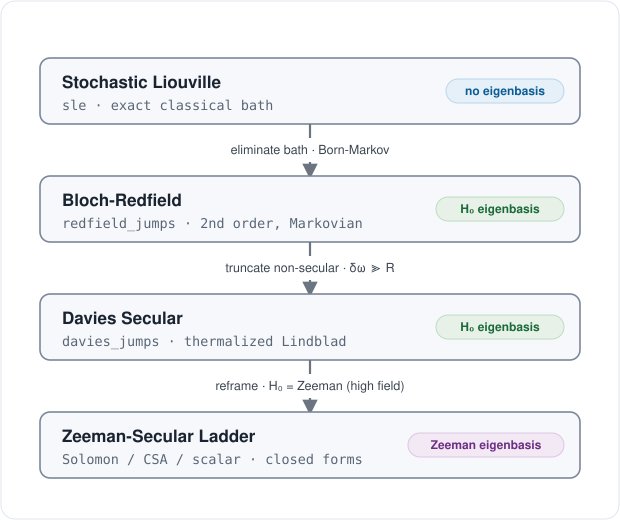
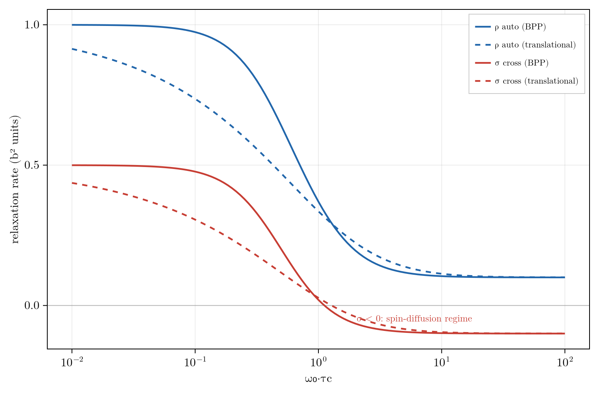

# Relaxation Backends

These backends are one physics at successive approximations; choose one by mechanism and regime below, then
read [The Reduction Ladder](@ref) for how the tiers reduce and where a mismatch returns a wrong number without
erroring. API docstrings are on the [Relaxation & Dissipators](@ref) page, the theory in [References](@ref)
("Open-system relaxation"); each mechanism also has a coherent Hamiltonian counterpart (`dipolar` / `csa`) on
the [Hamiltonian Terms](@ref) page.

## Choosing a Backend

- **High field, well-separated frequencies, a lattice-modulated coupling:** a **first-kind** model
  ([`DipolarRelaxation`](@ref) / [`CSARelaxation`](@ref) / [`ScalarRelaxation`](@ref)). At ultralow field or
  through level crossings, prefer [`redfield_jumps`](@ref) (non-secular, completely positive) or the exact
  stochastic route.
- **A fast-relaxing partner to eliminate** (radical, quadrupolar): a **second-kind** model
  ([`ScalarSecondKind`](@ref) contact, [`DipolarSecondKind`](@ref) through-space; [`mean_field_reduce`](@ref) emits the
  contact channel automatically when it eliminates an electron).
- **Cross-correlated mechanisms** (dipole-CSA interference): a Kossakowski matrix
  ([`kossakowski_matrix`](@ref)) fed to [`dissipators_from_kossakowski`](@ref): the interference lives in
  the off-diagonal rate-matrix entries and cannot be obtained by summing independent channels.
- **A discrete classical bath** (conformational exchange, QMEC tunneling): [`sle`](@ref) /
  [`propagate_sle`](@ref), exact at any field.

## The Reduction Ladder



From the exact top to the high-field closed forms at the bottom, two things change independently: the
**basis** the generator is written in (none at the top, then the ``H_0`` eigenbasis, then the Zeeman
eigenbasis, on the nodes) and the **approximation** at each step (an elimination or truncation, on the arrows).
The exact top is frame-agnostic, since a change of frame is only a unitary on the same generator.

Reading down: the exact stochastic Liouville equation holds at any field; eliminating the bath in a fast,
Gaussian limit gives the second-order Bloch-Redfield generator in the ``H_0`` eigenbasis; truncating the
non-secular cross-terms, those whose Bohr gap ``\delta\omega = \omega_{ab} - \omega_{cd}`` exceeds the rate
``R``, makes it secular (Davies); reframing to the Zeeman eigenbasis, valid only when Zeeman dominates,
collapses it to the closed forms. Below the Davies line the treatment is high-field-only; above it, it holds to
ultralow field (ULF). This exact top is also where the Nakajima-Zwanzig projection enters, since Redfield and
Lindblad are the Born-Markov limit of its memory kernel (see [Relation to Relaxation Theory](@ref)).

The bottom arrow is a validated gate. [`redfield_jumps`](@ref) takes the drift `H0`, the Hermitian coupling
operators, the bath `spectral` density, and `N`; with a pure-Zeeman drift it reproduces the Zeeman-secular
closed forms to `rtol = 1e-6`:

```jldoctest
julia> using RestrictedSpinDynamics

julia> N = 2; H0 = hamiltonian(zeeman(N, [100.0, 0.0]));      # dominant Zeeman = high field

julia> ops = dipolar_operators(N, 1, 2; coords = [(0.0,0.0,0.0), (0.0,0.0,2.0)], gammas = [2.675e8, 2.675e8]);

julia> jumps = redfield_jumps(H0, ops, BPP(1e-9), N);         # eigenbasis Redfield, secular (:davidovic)

julia> jumps isa Vector{Tuple{PauliDict,Float64}}
true
```

At a pure-Zeeman `H0` the resulting `σ`, `ρ` match [`solomon_rates`](@ref) to `rtol = 1e-6`, and
[`csa_operators`](@ref) reproduces the CSA `R1`/`R2`. These jumps are completely positive: the default
`:davidovic` geometric-mean rate equals the exact secular rate at wide Larmor gaps (reproducing Solomon and
CSA) and stays positive and accurate as the gaps close toward ULF, where the naive Bloch-Redfield tensor goes
non-positive. `:nathan_rudner` is the alternative (universal-Lindblad, one dressed jump per operator);
`method` selects. The ladder classifies by secularity; the orthogonal axis, Abragam's first versus second
kind, is [below](@ref "First versus Second Kind").

## Spectral Densities

A [`RelaxationModel`](@ref) turns a correlation time into rates through a [`SpectralDensity`](@ref):
[`BPP`](@ref) is the fixed-distance rotational (Bloembergen-Purcell-Pound) Lorentzian, and
[`Translational`](@ref) is the Hwang-Freed density for a diffusing partner (outer sphere). Pass `tau_c` for
BPP or ``J`` / ``\omega_0`` directly; the same model then feeds [`relaxation_jumps`](@ref).

Inner versus outer sphere selects the density. A bound, fixed-geometry partner uses a fixed distance and the
rotational [`BPP`](@ref) density (``\tau_c^{-1} = \tau_r^{-1} + T_{1e}^{-1}``); a freely diffusing radical
(dissolved trityl or O``_2``, the hyperpolarized-``^{13}``C lifetime case) has no fixed distance and uses the
[`Translational`](@ref) Hwang-Freed density with ``\tau_D = a^2/D`` (``a`` the distance of closest approach).
[`outer_sphere_second_kind`](@ref) assembles the outer-sphere channel and [`outer_sphere_r1`](@ref) returns
the per-mM relaxivity (validated: Gd``^{3+}``/water ``^1``H gives ``r_1 \approx 2\ \text{mM}^{-1}\text{s}^{-1}``,
the literature value). [`mean_field_reduce`](@ref) emits the inner-sphere contact channel when it eliminates a
hyperfine-coupled electron.

The choice of density reshapes the dispersion: the diffusion hallmark is the ``\sqrt{\omega}`` roll-off of
[`Translational`](@ref) against the Lorentzian of [`BPP`](@ref) (both normalized to ``J(0)=\tau_c``). The
cross-rate ``\sigma`` from [`solomon_rates`](@ref) changes sign near ``\omega_0\tau_c \approx 1``: positive
NOE in extreme narrowing, spin-diffusion at slow tumbling.



The Solomon cross-rate ``\sigma`` and the auto-relaxation rate against ``\omega_0\tau_c``, for the BPP and
Hwang-Freed spectral densities. ``\sigma`` crosses zero near ``\omega_0\tau_c \approx 1``.

## First versus Second Kind

Orthogonal to the ladder's secularity axis is what makes the coupling fluctuate. A **first-kind** mechanism
has the lattice modulate the coupling itself; the lattice function is a Gaussian process, so the second-order
(Redfield) rate is exact. A **second-kind** mechanism eliminates a fast-relaxing partner whose state modulates
the field it exerts; the partner is a single spin, so its bath is telegraph noise and the rate holds only in
the fast-partner limit (the eliminate-versus-joint test maps that window).

A bilinear two-spin coupling splits into three multipole ranks, ``\mathbf 1 \otimes \mathbf 1 = \mathbf 0
\oplus \mathbf 1 \oplus \mathbf 2`` (scalar, antisymmetric, dipolar), so a paramagnetic center relaxes a
nucleus through two second-kind channels: Fermi contact (rank 0) and through-space dipolar (rank 2), both
emitting grade-1 single-spin jumps once the partner is eliminated. The dipolar channel samples the partner
both transversely (``1/T_{2e}``) and longitudinally (``1/T_{1e}``), so [`DipolarSecondKind`](@ref) takes two
densities ``J_t`` and ``J_l`` (its longitudinal rate is the Solomon-Bloembergen-Morgan form); collapsing them
to a single ``\tau_c`` loses accuracy once the two correlation times differ.

| Kind | What fluctuates the coupling | Rank | Model | Correlation time |
|:------|:------------------------------|:------|:-------|:------------------|
| First | lattice modulates the coupling | 2 (tumbling) | [`DipolarRelaxation`](@ref), [`CSARelaxation`](@ref) | ``\tau_r`` |
| First | lattice modulates the coupling | 0 (exchange / QMEC) | [`ScalarRelaxation`](@ref) | ``\tau_{\text{ex}}`` |
| First | lattice modulates the EFG (single-spin) | 2 (quadrupole) | [`QuadrupolarRelaxation`](@ref) | ``\tau_r`` (or ``\tau_{\text{ex}}``) |
| Second | eliminated partner's state | 0 (contact) | [`ScalarSecondKind`](@ref) | partner ``T_{1e}/T_{2e}`` |
| Second | eliminated partner's state | 2 (through-space) | [`DipolarSecondKind`](@ref) | partner ``T_{1e}/T_{2e}`` or ``\tau_D`` |

### Higher-Spin Quadrupolar Relaxation

Quadrupolar relaxation of a spin ``\ge 1`` nucleus ([`QuadrupolarRelaxation`](@ref) /
[`quadrupole_relaxation`](@ref), with the [Higher-Spin](@ref) backends) is first kind, rank 2, and the only
single-spin interaction here: the nuclear quadrupole moment contracted with the lattice electric field
gradient, modulated by reorientation (``\tau_r``) or exchange (``\tau_{\text{ex}}``). It has no second-kind
counterpart, since that split needs a bilinear two-spin ``I\!\cdot\!S`` coupling. A quadrupolar nucleus enters
the second kind only as the eliminated partner: a spin-1/2 ``J``-coupled to a fast-relaxing quadrupolar nucleus
(``^1``H-``^{14}``N, ``^1``H-``^{35}``Cl) is handled by feeding its fast ``T_1/T_2`` to
[`ScalarSecondKind`](@ref) (Abragam's scalar relaxation of the second kind).

## Silent-Error Correspondences

A tier mismatch raises no error; it returns a plausible number for the wrong regime. The correspondences
below are where that happens.

### Frequency Sampling by Backend

A relaxation model evaluates its spectral density at transition frequencies, and the backends disagree on
which. The Zeeman-secular ladder samples at the fixed Zeeman gaps; the eigenbasis Redfield route samples at
the true eigen-gaps of the drift, which include the coupling. With drift ``H_0 = H_Z + H_J`` and Larmor
frequency ``\omega_0``,

```math
\text{Zeeman-secular:}\quad J\ \text{evaluated at}\ \{\,0,\ \omega_0,\ 2\omega_0\,\},
```
```math
\text{eigenbasis Redfield:}\quad J\ \text{evaluated at the eigengaps of}\ H_0
\ \xrightarrow[\ ]{\ \text{ULF}\ }\ \sim \omega_{ST}\ (\propto J) ,
```

where ``\omega_{ST}`` is the singlet-triplet gap, set by the coupling ``J``. At ultralow field the
coupling-to-Zeeman ratio is order one by design, so the two frequency sets diverge and Zeeman-secular
sampling fails; the eigenbasis Redfield route is the fix. Build the jumps in the eigenbasis instead, from the
same mechanism operator lists:

```julia
jumps = redfield_jumps(N, dipolar_operators(geom, model); H0 = zeeman(N, freqs) + jcoupling(...))
```

`DipolarRelaxation`, `CSARelaxation`, and `ScalarRelaxation` are high-field tools; at ULF use
[`redfield_jumps`](@ref) with [`dipolar_operators`](@ref) or [`csa_operators`](@ref). The worked ZULF case is
in [Zero- and Ultralow-Field (ZULF) Simulations](@ref).

### Exact versus Approximate

Each entry adds one assumption to the one above.

- **Exact classical bath.** [`sle`](@ref) / [`two_state_exchange`](@ref) -> [`propagate`](@ref) (or the
  explicit [`propagate_sle`](@ref)): a Kubo-Anderson stochastic Liouville equation for classical M-state noise
  (two-state tunneling, motional narrowing). No Markov, secular, or weak-coupling assumption; valid at any
  field and through crossings. The preferred QMEC-lifetime backend.
- **Phenomenological non-Markovian (post-Markovian).** [`pome`](@ref): the Markovian Lindbladian convolved
  with an exponential memory kernel ([Shabani-Lidar](@ref ref-shabani-lidar)), interpolating between the Markovian limit (`γ -> ∞`) and
  memory-retaining dynamics at finite `γ`. A phenomenological bridge; use it when a measured memory time is
  the input. Experimental.
- **Projection reduction (first-principles non-Markovian).** When the "bath" is a retained sub-basis rather
  than an external reservoir, the Nakajima-Zwanzig split folds it back from the Liouvillian itself, not from a
  phenomenological memory time; see [Nakajima-Zwanzig Formalism](@ref). Experimental.
- **Second order and Markov, eigenbasis-secular.** [`redfield_jumps`](@ref): weak-coupling in the bath and
  secular in the eigenbasis of the full drift, valid at coupling-to-Larmor ratios of order one; it is weak in
  the bath, not in the coupling ``J``. With `thermalize = true` it becomes the thermalizing
  [`davies_jumps`](@ref) (detailed-balance generator, full-``H_0`` frame) / [`bengs_levitt_jumps`](@ref)
  (the Bengs-Levitt Lb method, dominant-``H`` frame), relaxing to the Boltzmann state.
- **Redfield with the added Zeeman-secular assumption.** `DipolarRelaxation`, `CSARelaxation`,
  `ScalarRelaxation`: add the "Zeeman dominates" assumption, which breaks at ultralow field.
- **A representation, independent of approximation level.** [`kossakowski_matrix`](@ref) /
  [`dissipators_from_kossakowski`](@ref): the GKSL rate matrix and its eigen-jump decomposition. Any backend
  above can be written through it, and it is the seam for cross-correlated channels.

The phenomenological [`pome`](@ref) rung takes a prebuilt Markovian generator and a memory rate `gamma` (the
kernel is `γ·e^{-γt}`, so the memory time is `1/γ`), embedding it as a local generator on the state plus one
auxiliary block:

```jldoctest
julia> using RestrictedSpinDynamics

julia> b = restricted_basis(1, 1);

julia> L = build_liouvillian(b, PauliDict(); jumps = decay(1, 1:1, 1.0));   # the Markovian core

julia> m = pome(L; gamma = 5.0);          # finite gamma retains memory; gamma -> Inf is Markovian

julia> (m.d, size(m.M))                    # physical block size, enlarged generator size
(4, (8, 8))
```

### Complete Positivity

- Zeeman-secular ladder jumps: completely positive by construction.
- `:nathan_rudner`: manifestly completely positive, one dressed jump per operator.
- `:davidovic` (default): completely positive by construction; its geometric-mean rate keeps the rate matrix
  positive semidefinite and reduces to the exact secular (Solomon / CSA) rate when the Bohr gaps are wide.
- Naive non-secular Bloch-Redfield: not completely positive, which is why the Kossakowski path guards the
  minimum eigenvalue against ``-\texttt{tol}`` before emitting jumps.
- Stochastic Liouville: completely positive, being a physical classical mixture.

### Detailed Balance and Thermalization

The Zeeman-secular backends carry a KMS factor ``e^{-\beta\omega/2}`` (the `thermalize` flag) and relax to the
Boltzmann state ``\rho_\infty \propto e^{-\beta H_0}``. The eigenbasis route gets the same factor from
[`redfield_jumps`](@ref)`(...; thermalize = true, beta)`, exposed as two presets: [`davies_jumps`](@ref)
(secular in the full ``H_0`` eigenbasis, correct at ultralow field) and [`bengs_levitt_jumps`](@ref) (secular
in the dominant Hamiltonian, the [Bengs-Levitt "Lb" method, JMR 310 (2020) 106645](@ref ref-bengs-levitt)). Without `thermalize`,
`redfield_jumps` gives infinite-temperature symmetric rates; for a thermal fixed point with cross-correlated
mechanisms, KMS-weight the [`kossakowski_matrix`](@ref) instead.

Both presets build directly from the drift Hamiltonian, the coupling operator(s), a spectral density, and the
inverse temperature `beta`:

```jldoctest
julia> using RestrictedSpinDynamics

julia> H0 = hamiltonian(zeeman(1, [10.0]));

julia> jd = davies_jumps(H0, spin_op(1, 1, 1), BPP(1e-3), 1; beta = 0.05);   # full-H0 eigenbasis

julia> jd isa Vector{Tuple{PauliDict,Float64}}
true

julia> HA = hamiltonian(zeeman(2, [100.0, 100.0]));     # dominant Zeeman = the secular frame

julia> length(bengs_levitt_jumps(HA, [spin_op(2, 1, 1), spin_op(2, 2, 1)], BPP(1e-3), 2; beta = 0.02))
4
```

### Independent Sum versus Cross-Correlation

Mechanisms fed as separate operators relax independently and their dissipators add, correct for isotropic
tumbling. Cross-correlated relaxation, the interference between two mechanisms driven by the same motion,
cannot be had that way; it lives in the off-diagonal entries of the GKSL rate matrix. It is the dipole-CSA
interference TROSY exploits to keep one multiplet component sharp in large proteins, and the cross-correlation
that leaks nuclear singlet order (giving a would-be long-lived state a finite lifetime):

```math
\text{separate operators:}\quad \mathcal D[A] + \mathcal D[B]\ \ (\text{independent});
\qquad
\text{rate matrix } \rho_{AB}:\quad \mathcal D[A+B]\ \text{cross terms},
```

with ``\rho_{AB}=0`` recovering the independent sum and ``\rho_{AB}=\pm 1`` the fully correlated (TROSY)
limit. The differential (``\eta``) rate of a dipolar-CSA pair is assembled through the rate matrix:

```jldoctest
julia> using RestrictedSpinDynamics

julia> A = spin_op(2, 1, 3); B = spin_op(2, 2, 3);           # the two mechanism operators

julia> C = kossakowski_matrix([1.0, 1.0], [1.0 0.7; 0.7 1.0], 0.1);   # amplitudes, correlation ρ_AB, J(ω)

julia> jumps = dissipators_from_kossakowski([A, B], C);      # eigen-jumps of the rate matrix

julia> length(jumps)                                         # cross-correlated -> mixed modes
2
```

## Practical Notes

### Convention Traps

These are code-side conventions whose factors are easy to drop.

- [`spin_op`](@ref) is ``I_a = \sigma_a/2`` (coefficient one half); [`spin_pm`](@ref) is ``I_\pm`` with unit
  matrix element. That mismatch is why the single-quantum dipolar jumps carry an explicit factor of two.
- [`zeeman`](@ref)`(N, freqs)` takes frequencies in Hz and multiplies by ``2\pi`` internally, so a Bohr gap
  of ``\omega_0`` (rad/s) needs `freqs = omega0 / (2pi)`. Redfield then samples ``J`` at those gaps in rad/s.
- A dephasing jump ``\mathcal D[I_z]`` contributes at *half* its jump rate: a rate-``w`` ``I_z`` jump adds
  ``w/2`` to ``R_2``. This factor is exactly what sets the CSA secular weight ``w_0 = 8q/45``.

### Grade and Sector

- Every pair operator here is grade-2, so [`restricted_basis`](@ref) needs ``k_{\max}\ge 2``.
- Longitudinal observables (``I_z``, singlet order) live in the weight-0 sector, and the ladder jumps close
  it, so `check_sector = true` is safe. Only a [`field_ramp`](@ref) together with a transverse
  [`drive_field`](@ref) needs the full basis with `check_sector = false`.

### Rates and Fixed Points Without Propagating

A large physical scale separation (electron Zeeman far above nuclear far above relaxation) makes integrating
the full trajectory wasteful; two one-liners skip it. [`initial_rate`](@ref)`(basis, L, c0, O)` reads the
initial slope straight from the dissipator,
``-\operatorname{Re}\langle O, \mathcal L c_0\rangle / \operatorname{Re}\langle O, c_0\rangle``: one
``\mathcal L c_0`` (and, for Redfield, one eigendecomposition) per field point, the idiom for ``T_1``/``T_2``
versus field. [`steady_state`](@ref)`(basis, L)` solves ``\mathcal L c = 0`` with a trace constraint as a
sparse linear solve, jumping past the stiff transient. [`rate_vs_field`](@ref) runs the `initial_rate` readout
across a whole sweep, returning the rate (or a cross-relaxation-matrix row) per point: pass a `make_L(B)` when
the coherent `H(B)` disperses (the eigenbasis-Redfield case), or a fixed `H` plus a `make_jumps(B)` for a
closed-form NMRD / relaxivity profile (the nitroxide NMRD gate uses the latter). [`sweep_field`](@ref) is the
general form, any readout over the sweep: a [`steady_state`](@ref)-based readout gives a transferred-
polarization profile (a SABRE or level-anti-crossing field sweep) instead of a rate.

```jldoctest multiscale
julia> using RestrictedSpinDynamics

julia> b = restricted_basis(2, 2);

julia> H = hamiltonian(zeeman(2, [0.0, 10.0]), jcoupling(2, 1, 2, 5.0));

julia> L = build_liouvillian(b, H; jumps = dissipator(decay(2, 1:2, 0.5)));

julia> c0 = state(b, polarized(1:2, :z)); O = total_spin_op(2, :z);

julia> round(initial_rate(b, L, c0, O); digits = 4)        # the T1 slope, no propagation
1.0

julia> ss = steady_state(b, L);                            # jump straight to the fixed point

julia> round(real(expect(b, ss, O)); digits = 6)           # fully relaxed to the -z ground
-1.0
```

This [`steady_state`](@ref) is ``\rho_\infty = \ker\mathcal L`` of a *linear* Lindbladian; the *nonlinear*
mean-field operating point of a feedback (RASER) loop, where the generator depends on the state, is
[`fixed_point`](@ref) / [`feedback_threshold`](@ref) on the
[Reachability, Control, and the Adaptive Basis](@ref) page.

## Validation

Each backend is checked against a closed form or experiment (`test/test_relaxation.jl` and the
`scripts/validation/` gates): dipolar against the Solomon ``\sigma`` and ``\rho`` rates, CSA against the
axial rates, the paramagnetic second-kind models against the SBM closed form and a nitroxide NMRD profile
across eight field decades, and [`redfield_jumps`](@ref) against the Zeeman-secular backends at high field.
When you switch tiers, re-check the observable: the reduction ladder is exactly the map of what each tier
assumes.
