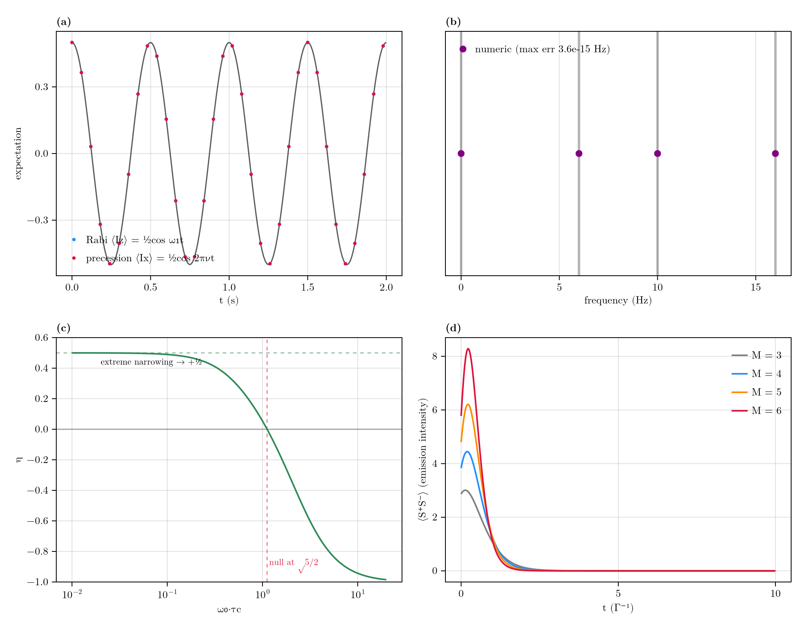
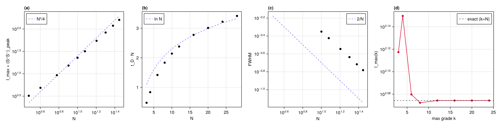
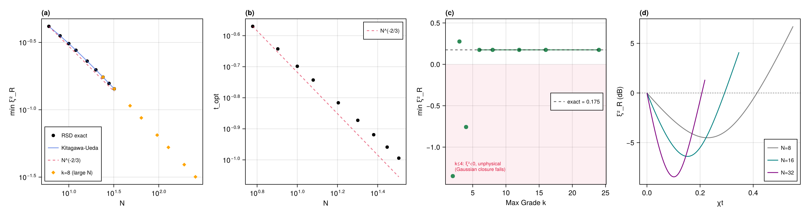
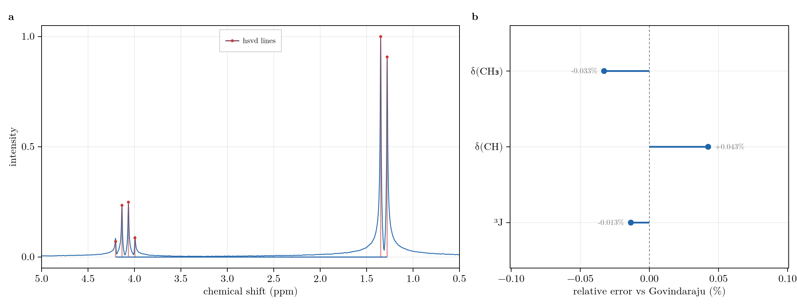

# Validation

The restricted-basis method is an approximation that becomes **exact** when the dynamical Lie algebra closes
at or below the retained grade. Each check below compares against an analytic or exact reference, full
diagonalization where the dense operator still fits, and is gated in the unit-test suite (`test/`). Performance
is in [Benchmarks](@ref).

## Validation Summary

| System | Reference | Result |
| :--- | :--- | :--- |
| AA'X coherent + dissipative (3-spin) | exact 8x8 diagonalization | full-grade SSR matches to `< 1e-9` (the core assembly gate) |
| Higher-spin dynamics (spin-1, spin-3/2) | exact `d^N` Lindblad superoperator | full-grade tensor-restricted equals exact to machine precision |
| Permutation-symmetric sector | full-basis propagation | identical to `2e-16` |
| Single spin (Rabi + free precession) | analytic nutation and precession | on the analytic curve |
| AB strong coupling | analytic stick spectrum `1/2(nuA+nuB) +- 1/2 R +- 1/2 J` | transitions reproduced exactly |
| Homonuclear NOE (Solomon) | `eta = sigma/rho`, max `+1/2`, null at `w0*tauc = sqrt(5)/2` | on the Solomon curve |
| SABRE buildup | dense [Barskiy Eq. (72)](@ref ref-barskiy) two-compartment | reproduced at full grade (transfer needs grade `>= 3`) |
| Two-site chemical exchange | classical Bloch-McConnell lineshape | SLE engine reproduces the coalescence series to `1e-14` |
| 2D NOESY pulse program (strychnine) | Solomon `exp(-R*tmix)` transfer | full `noesygpph` sequence transfer matches to `6.9e-4` |
| Landau-Zener transfer | adiabatic-following limit | adiabatic sweep transfers, diabatic does not |
| Dicke superradiant burst | Gross-Haroche `I_max ~ N^2`, `t_D ~ ln(N)/N`, `FWHM ~ 1/N` | scaling exponents reproduced |
| One-axis-twisting squeezing | Kitagawa-Ueda `min xi^2_R ~ N^(-2/3)` | matches the analytic `xi^2` to `8.5e-7` |
| Grade-truncation exactness floor | reachable-set grade = exactness grade | empirical equals predicted across the model family |
| System ID gradient ([`Inference.fit`](@ref RestrictedSpinDynamics.Inference.fit)) | central FD of the summed objective | exact adjoint structural gradient matches to `1e-6` |
| Cramer-Rao uncertainty ([`Inference.uncertainty`](@ref RestrictedSpinDynamics.Inference.uncertainty)) | 400-trial Monte-Carlo refit; exact Fisher Jacobian | refit scatter tracks the CRB to within `~10%`; CRB exactly linear in `sigma`; Jacobian gated to `1e-3` vs Fréchet |
| Separable (VARPRO) fit | synthetic 2-component FID | frequencies, rates, and amplitude ratio recovered |
| Line estimation ([`Inference.hsvd`](@ref RestrictedSpinDynamics.Inference.hsvd)) | closed-form AB quartet + Govindaraju (2000) lactate `delta`/`J` | lines recovered seed-free to the analytic and published values (`< 0.05 Hz`, `< 0.002 ppm`) |
| Moving-horizon estimation ([`Inference.smooth`](@ref RestrictedSpinDynamics.Inference.smooth)) | incomplete-measurement state recovery | beats snapshot `tomography`, near-exact when the window is complete |
| Leggett-Garg ([`Inference.leggett_garg`](@ref RestrictedSpinDynamics.Inference.leggett_garg)) | analytic `K3(wt) = 2cos(wt) - cos(2wt)` | matches at four `wt` to `1e-5`; `K3 = 3/2` at `wt = pi/3`, decoherence drives `K3 <= 1` |

## Exact Reductions Against Full Diagonalization

The method's central claim is that its reductions are **lossless**. Three gates establish
this against the full reference, each at the largest size where the dense reference still fits.

- **The core gate.** On the three-spin AA'X system (weak and strong coupling together) the full-grade
  restricted Liouvillian reproduces the exact `8x8` diagonalization to `< 1e-9` in both the coherent spectrum
  and the dissipative steady state. This single gate certifies the whole assembly: basis, string algebra,
  Liouvillian, and propagator.
- **Higher spin.** The tensor-restricted path packs `d^2 - 1` letters per site; at full grade it equals the
  exact `d^N` Lindblad dynamics to machine precision for spin-1 (`d = 3`) and spin-3/2 (`d = 4`).
- **Symmetry.** A permutation-symmetric [`SpinClasses`](@ref) sector reproduces the full-basis dynamics of a
  collectively-pumped system to `2e-16`. The orbit-summed sector reproduces the full dynamics exactly; it is
  not a mean-field approximation.

## Textbook Coherent and Relaxation Physics

Four canonical checks drawn directly onto their analytic references: single-spin Rabi nutation and free
precession, the AB strong-coupling stick spectrum, the Solomon steady-state nuclear Overhauser curve, and the
collective superradiant burst.



**(a)** Rabi nutation and free precession on the analytic curve. **(b)** The AB strong-coupling stick spectrum
at the analytic frequencies. **(c)** The NOE enhancement eta vs w0*tauc, with its +1/2 maximum and sqrt(5)/2
null. **(d)** Superradiant bursts, peak growing and delay shortening with spin number.

In the NOE panel the steady-state enhancement `eta = sigma/rho` traces the full Solomon dependence on
`w0*tauc`, hitting the extreme-narrowing maximum of `+1/2` and the characteristic null at
`w0*tauc = sqrt(5)/2` where the cross-relaxation changes sign. The AB panel recovers the exact strong-
coupling transition frequencies and the roofing intensities that distinguish an AB system from two singlets.

## Collective Scaling Laws

Beyond fixed-size checks, the method reproduces the *scaling* of collective-spin phenomena, the regime where
a full `4^N` treatment is out of reach but the symmetric sector stays small.

### Dicke Superradiance

A fully-inverted Dicke state decaying through a collective jump produces the Gross-Haroche superradiant burst.
The peak intensity grows as `N^2`, the delay to the peak as `ln(N)/N`, and the burst narrows as `1/N`; the
restricted dynamics reproduce all three laws over the exactly-propagated range.



**(a)** Peak intensity tracking N^2/4 (log-log). **(b)** Peak delay times N tracking ln(N). **(c)** Burst width
tracking 1/N. **(d)** Grade demand: intensity converges to the exact value as the retained grade grows.

The fourth panel shows the cost: the fully-inverted burst is a high-grade transient, so its peak intensity
converges to the exact value only as the retained grade grows.

### Spin Squeezing

One-axis twisting, `H = chi * Sz^2` acting on a coherent spin state, is the canonical route to metrologically
useful entanglement. The Wineland squeezing parameter follows the Kitagawa-Ueda law: its optimum deepens as
`N^(-2/3)` and arrives at a time scaling as `N^(-2/3)`.



**(a)** The minimum Wineland parameter following N^(-2/3), on the Kitagawa-Ueda curve. **(b)** The optimal
squeezing time, N^(-2/3). **(c)** Grade demand. **(d)** The squeezing dip (dB) deepening with spin number.

Because the squeezing is built from collective second moments and the state stays permutation-symmetric, a
fixed low grade reproduces the exact optimum across the whole range: the squeezing parameter matches the
analytic `xi^2` to `8.5e-7`. The grade-demand panel also marks the floor below which a second-moment closure
turns unphysical (`xi^2 < 0`): the useful squeezing lives above it.

## Polarization Transfer

The transfer sequences that motivate the method reproduce their established references. SABRE buildup, run as
coherent evolution plus relaxation plus chemical exchange, matches the dense [Barskiy Eq. (72)](@ref ref-barskiy)
two-compartment model at full grade; the singlet-to-substrate transfer needs grade `>= 3` (its exactness
floor), so a grade-2 free pool cannot carry it. A Landau-Zener field ramp through a `J`-coupled avoided
crossing transfers polarization in the adiabatic limit and leaves it untouched in the diabatic one. This is
the same level-anti-crossing mechanism behind low-field SABRE transfer, in its cleanest two-spin form.

The same sequence engine runs the full `noesygpph` 2D NOESY program on 22-spin strychnine (a
`256 x 1024` phase-cycled acquisition with a z-filter and 400 ms of relaxation mixing) and stays stable and
physical across the whole program. Its transfer is gated against the Solomon `exp(-R*tmix)` matrix on a
subcluster to `6.9e-4`; the worked spectrum is in [Reachability, Control, and the Adaptive Basis](@ref).

## The Exactness Floor

Every result above rests on one principle: grade-``k`` truncation is exact precisely when the strings the
dynamics can populate all have grade ``\le k``. That reachable-set floor is the exactness criterion, and the
empirical grade at which the restricted dynamics first meet the full reference matches it for every member of
the family below. The floor is set by the coupling topology (the largest connected cluster) rather than the
spin count:

| Coupling geometry | Closing grade |
| :--- | :--- |
| Uncoupled spins | 1 |
| A J-coupled pair (AX / AB), other spins isolated | 2 |
| AA'X, three mutually coupled spins | 3 |
| A linear chain or ring of ``N`` coupled spins | ``N`` |
| ``M`` disjoint ``m``-spin clusters | ``m`` |


One row per system (chain/ring/star/all-to-all x Ising/XY/Heisenberg/dipolar): the reachable floor (diamond,
the exact grade) against the state-independent H-term DLA grade (cross), red where the bare-generator estimate
undershoots the floor.

The cross is the cheap estimate from the Hamiltonian terms alone; the diamond is the exact floor, the largest
grade the initial state reaches under the dynamics. The state reaches correlations the terms alone never do, so
the diamond can sit to the right of the cross. Ising coupling makes the gap plain: the ``ZZ`` terms close at
grade 2 on every topology, but a single transverse excitation spreads to grade 2 at a chain end, 3 on a ring,
and 6 at a star hub, where one spin couples to all the rest. Only the diamond certifies exactness, and the
boundary block is assembled directly as the certificate:

```julia
d = dla_dimension(N, collect(keys(H)))   # DLA size; compare to basis_size(N, kmax) for the saving
m = leakage_operator(N, kmax, H; jumps = jumps)
norm(leakage_block(m))                    # 0 certifies exactness at this kmax; small values bound the error
```

Below the closing grade, grade truncation becomes a convergence-controlled approximation; its rate is the
subject of [The Convergence Rate](@ref).

## Line Estimation

The direct line estimator [`hsvd`](@ref RestrictedSpinDynamics.Inference.hsvd)
([Hankel-SVD / matrix pencil](@ref ref-hsvd))
recovers an FID's frequencies, decay rates, and amplitudes in one non-iterative pass, with no starting guess.
Those lines seed a structural [`fit`](@ref RestrictedSpinDynamics.Inference.fit), whose time-domain
least-squares cost is multimodal in the frequencies and would otherwise need a starting guess close to the
solution.

The analytic reference is the two-spin **AB quartet**. The four recovered lines land on the closed-form
positions ``\pm C \pm \tfrac12 J``, where ``2C = \sqrt{\Delta^2 + J^2}``; ``\Delta`` and ``J`` come back to
within `< 0.05 Hz`, and the roofing intensity ratio matches ``(2C-J)/(2C+J)``.

On a synthetic three-line FID, `hsvd` returns the frequencies and damping seed-free, with no peak-picking:

```@example validation
using RestrictedSpinDynamics.Inference

# ground truth: a noiseless FID built from three decaying complex exponentials
dt = 1e-3; nsamp = 2000
freqs   = [120.0, 250.0, 410.0]        # Hz
damping = [6.0, 9.0, 4.0]              # decay rates 1/T2* (s^-1)
amps    = [1.0, 0.6, 0.3]
fid = ComplexF64[sum(amps[k] * cis(2π*freqs[k]*dt*n) * exp(-damping[k]*dt*n) for k in 1:3) for n in 0:nsamp-1]

# hsvd sees only the samples and dt, not the line count, nor any of the values above.
# It infers the model order from the Hankel singular-value gap, then solves for the poles,
# so recovering the three freqs and rates below is a blind estimate, not a fitted readback.
l = hsvd(fid, dt)
(freqs = round.(sort(l.freqs); digits = 2), damping = round.(sort(l.damping); digits = 2))
```

The published reference is **lactate** (an A3X system: a CH3 doublet and a CH quartet). Its chemical shifts and
``{}^3J`` coupling were tabulated by [Govindaraju, Young & Maudsley](@ref ref-govindaraju) (NMR Biomed 13:129, 2000), the compilation
from which the LCModel and related basis sets used to quantify every clinical ``{}^1``H MRS spectrum are built,
making it the field's ground-truth metabolite table, not an arbitrary target. From a simulated lactate FID,
`hsvd` recovers ``\delta(\mathrm{CH_3})``, ``\delta(\mathrm{CH})``, and ``{}^3J`` seed-free (no peak-picking,
no starting guess) to within `0.002 ppm` and `0.001 Hz` of the tabulated values, under `0.05%` relative error
on each. Recovering the reference parameters this tightly, without supervision, is what licenses using `hsvd`
as the front end that seeds a coupled-spin [`fit`](@ref RestrictedSpinDynamics.Inference.fit).



**(a)** The simulated lactate spectrum with the hsvd-recovered lines as sticks (methyl doublet ~1.3 ppm,
methine quartet ~4.1 ppm). **(b)** The signed relative error of each recovered quantity (delta(CH3), delta(CH),
3J) against the Govindaraju reference, all within 0.05%.

## Reproducing

```
julia --project=scripts scripts/validation/validate_physics.jl     # -> scripts/validate_physics.png
julia --project=scripts scripts/experiments/dicke_scaling.jl       # -> data/dicke_scaling.csv
julia --project=scripts scripts/experiments/spin_squeezing_oat.jl  # -> data/spin_squeezing_oat.csv
julia --project=scripts scripts/analysis/dla_exactness_map.jl      # -> data/dla_exactness_map.csv
julia --project scripts/validation/validate_crb.jl                 # CRB efficiency: MC refit std == CRB
julia --project scripts/validation/validate_two_compartment.jl     # SABRE == Barskiy Eq. (72)
julia --project scripts/validation/validate_higher_spin.jl         # higher-spin exactness gate
julia --project scripts/validation/validate_weak_symmetry.jl       # symmetric sector == full basis
```

The AA'X core gate and the higher-spin and symmetry exactness checks run as part of the unit-test suite
(`julia --project -e 'using Pkg; Pkg.test()'`).
